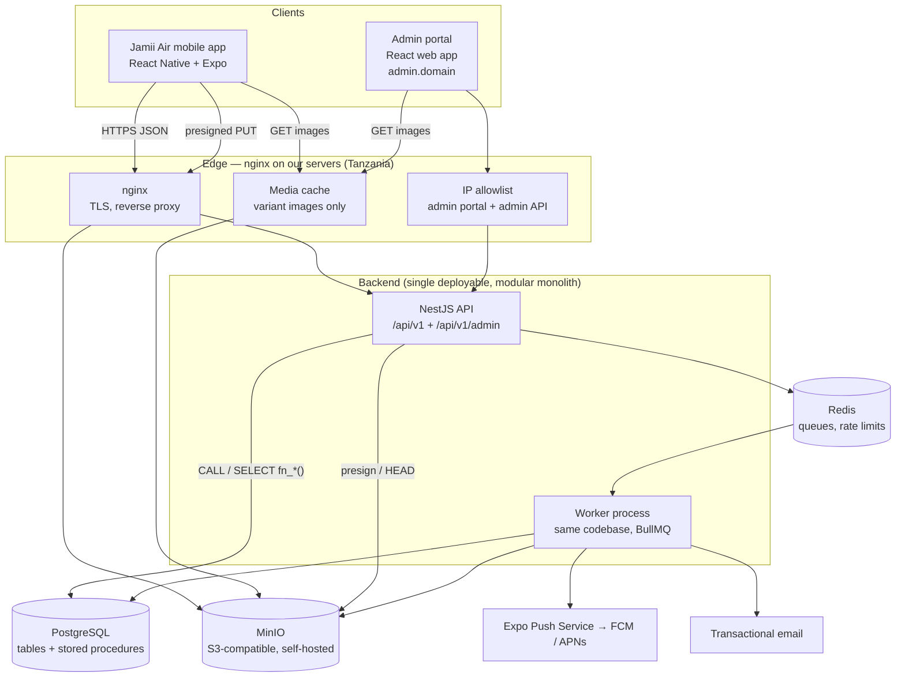
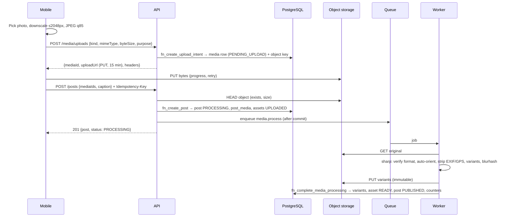

# Jamii Air — Technical Requirements Document (TRD)

| | |
|---|---|
| **Document** | 02 — Technical Requirements Document |
| **Version** | 1.3 (stakeholder decisions D-1…D-12 applied — see [00 §3](00-README.md)) |
| **Status** | **Approved** — 2026-10-11 |
| **Date** | 2026-10-10 |
| **Scope** | Release 1 (MVP) in detail; R1.1–R4 as forward-compatibility requirements |
| **Related** | [01 BRS](01-business-requirements-specification.md) · [05 Schema](05-backend-schema-document.md) · [06 Plan](06-implementation-plan.md) |

---

## 1. Guiding principle

> **Keep the architecture simple, but never make the data flow, media flow, or API contracts fundamentally hard to scale.**

Every requirement below is either (a) needed for R1, or (b) a cheap decision now that avoids an expensive rewrite later. Anything else is deferred. AI/ML is out of scope for the MVP (D-4).

## 2. System architecture

### 2.1 Context



All components run as one **Docker Compose** stack per environment on our own servers in a Tanzanian data centre (decision D-9). In this document, **"CDN" means the nginx media cache** in front of MinIO; a third-party CDN can be put in front of it later without code changes.

### 2.2 Key architectural rules

| ID | Rule |
|---|---|
| AR-01 | One backend codebase, deployed as two process types: `api` (HTTP) and `worker` (queue consumers). Same image, different entrypoint. |
| AR-02 | Modules communicate through exported service interfaces, never by reaching into another module's repository directly. |
| AR-03 | PostgreSQL is the only source of truth. Redis holds only reconstructable data (queues, rate-limit counters, caches). |
| AR-04 | Media bytes never pass through the API: upload = presigned PUT direct to storage; download = CDN (nginx media cache). |
| AR-05 | Anything the user doesn't need to wait for (image processing, push, email, cleanup) runs in the worker. |
| AR-06 | All list endpoints are cursor-paginated from day one. |
| AR-07 | The client is never trusted: every authorization decision is made on the server (NestJS guards + checks inside stored procedures). |
| AR-08 | **All data-changing activities and all complex reads are PostgreSQL stored procedures** (D-3, §6). Prisma owns schema, migrations and simple reads. |
| AR-09 | The admin portal is a separate web app with separate admin accounts; it shares the API process but uses its own route prefix, auth and guards (§8). |

## 3. Technology stack

| Layer | Choice | Notes |
|---|---|---|
| Mobile framework | **React Native + Expo** (current SDK), **TypeScript** strict | EAS Build for binaries; EAS Update for OTA JS updates. |
| Navigation | React Navigation (native stack + bottom tabs) | |
| Server state | TanStack Query | Caching, dedupe, infinite queries, optimistic updates. |
| Client state | Zustand (auth session, preferences only) | No server data in Zustand. |
| Lists | `@shopify/flash-list` | All feeds, grids, comment lists. |
| Images | `expo-image` | Disk + memory cache, blurhash placeholders. |
| Animation / gestures | Reanimated, Gesture Handler | Double-tap like, transitions. |
| Secure storage | `expo-secure-store` | Refresh token. |
| Media capture | `expo-image-picker`, `expo-image-manipulator` | Client-side downscale to ≤ 2048 px before upload. |
| Push | `expo-notifications` | |
| i18n | `i18next` + `expo-localization` | `en`, `sw`. |
| **Admin portal** | **React + Vite + TypeScript**, React Router, TanStack Query + TanStack Table, Tailwind CSS + shadcn/ui, react-hook-form + zod | Static build served by nginx on our servers; English only. |
| Backend framework | **NestJS 12**, Node.js 24 LTS, TypeScript, ESM | Existing scaffold in `backend/`. |
| ORM / migrations | **Prisma** (schema, migrations, simple reads) | **TypedSQL** (`prisma/sql/*.sql` + `$queryRawTyped`) for typed calls to stored procedures. |
| Business logic in DB | **PostgreSQL stored procedures** — PL/pgSQL / SQL functions: `fn_*` (activities), `fn_admin_*`, `fn_maint_*` (batch maintenance) | §6. |
| Database | **PostgreSQL 18+** | Native `uuidv7()` for DB-generated IDs (rows are inserted by stored procedures). Extensions: `citext`, `pg_trgm`. |
| Queue | **BullMQ** on **Redis 7** | Introduced with the media worker (Plan task 2.7). |
| Validation | `class-validator` + `class-transformer`, global `ValidationPipe` (whitelist, forbidNonWhitelisted) | Input shape validated in Nest; business rules validated in the stored procedure. |
| API docs | `@nestjs/swagger` → OpenAPI 3.1 | Mobile and admin generate types with `openapi-typescript`. |
| Auth | `@nestjs/jwt`, opaque refresh tokens, `argon2` (Argon2id), `otplib` (admin TOTP) | Hashing happens in Node; stored procedures receive hashes only. |
| Rate limiting | `@nestjs/throttler` (in-memory → Redis storage from Plan task 2.7) | |
| Image processing | `sharp` | WebP output, EXIF strip, blurhash. |
| Object storage SDK | `@aws-sdk/client-s3` + `s3-request-presigner` | MinIO (self-hosted); any S3-compatible store works unchanged. |
| Logging | `pino` via `nestjs-pino` (JSON) | Secret redaction. |
| Errors / APM | Sentry (API, worker, mobile, admin) | |
| Product analytics | PostHog | KPI events only (§12). |
| Testing | Vitest, Supertest, Testcontainers (Postgres/Redis), Maestro (mobile E2E), Playwright (admin E2E), k6 (load) | |
| CI/CD | GitHub Actions | |
| Local dev | Docker Compose: Postgres, Redis, MinIO, Mailpit | |

## 4. Repository structure

```text
jamii-air/
├── backend/                 # NestJS API + worker + Prisma + stored procedures
│   └── docker-compose.yml   # local stack: Postgres, Redis, MinIO, Mailpit
├── mobile/                  # Expo React Native app (Plan Phase 3)
├── admin/                   # Admin portal web app (Plan Phase 4)
├── docs/                    # These documents
└── .github/workflows/
```

### 4.1 Backend layout

```text
backend/
├── prisma/
│   ├── schema.prisma
│   ├── migrations/                 # generated + hand-written SQL (tables, functions)
│   ├── functions/                  # SOURCE OF TRUTH for stored procedures, one file each
│   │   ├── auth/      fn_register_user.sql, fn_rotate_refresh_token.sql, …
│   │   ├── social/    fn_follow_user.sql, fn_block_user.sql, …
│   │   ├── posts/     fn_create_post.sql, fn_get_home_feed.sql, …
│   │   ├── engagement/ fn_like_post.sql, fn_add_comment.sql, …
│   │   ├── notifications/ …
│   │   ├── moderation/ …   admin/ …   maintenance/ fn_maint_purge_deleted_accounts.sql, …
│   │   └── _common/   fn_raise.sql, fn_assert_can_interact.sql, …
│   ├── sql/                        # TypedSQL call files: SELECT … FROM fn_x($1,$2)
│   └── seed.ts
└── src/
    ├── main.ts / worker.ts / app.module.ts
    ├── common/          # guards, filters (incl. DB error → API error), pagination, decorators
    ├── config/
    ├── infrastructure/  # prisma/, db-procedures/ (typed wrappers), storage/, queue/, push/, mail/
    ├── modules/         # auth, users, follows, media, posts, feed, likes, comments,
    │                    # notifications, safety, invites
    ├── admin/           # admin-auth, admin-reports, admin-users, admin-content,
    │                    # admin-invites, admin-dashboard, admin-audit (separate guards)
    └── workers/         # media.processor, notification.processor, maintenance.processor
```

### 4.2 Mobile layout

```text
mobile/src/
├── app/  navigation/  components/  api/  store/  i18n/  theme/  utils/
└── features/ auth/ profile/ feed/ posts/ comments/ notifications/ search/ follows/ media/ settings/
```

### 4.3 Admin portal layout

```text
admin/src/
├── app/ (router, providers, auth guard)
├── api/ (generated types, fetch client with cookie refresh)
├── features/ dashboard/ reports/ users/ content/ invites/ audit-log/ admins/
├── components/ (table, filters, detail panels, confirm-with-note dialog)
└── lib/
```

## 5. API standards

| ID | Requirement |
|---|---|
| API-01 | Base path `/api/v1` (mobile) and `/api/v1/admin` (portal). Breaking changes require `/api/v2`. |
| API-02 | JSON, `camelCase` fields, ISO-8601 UTC timestamps, UUID string IDs. |
| API-03 | Mobile auth: `Authorization: Bearer <accessToken>`. Admin auth: §8.2. |
| API-04 | Lists: `?limit=` (default 20, max 50) and `?cursor=`; response `{ "items": [...], "nextCursor": "..." \| null }`. Cursors are opaque base64url. Admin tables may also use `?page=` for small, bounded result sets. |
| API-05 | Error envelope: `{ "error": { "code": "POST_NOT_FOUND", "message": "…", "details": {…} }, "requestId": "…" }`. Codes raised inside stored procedures pass through unchanged (§6.4). |
| API-06 | Every response carries `X-Request-Id`. |
| API-07 | Mobile sends `X-App-Version` and `X-Platform`; server can return `426 APP_VERSION_UNSUPPORTED` (`details.minVersion`) when the version is below `MIN_APP_VERSION`. |
| API-08 | `POST /posts` and `POST /posts/:id/comments` accept `Idempotency-Key`; duplicates within 24 h return the original result. |
| API-09 | Responses are screen-shaped: explicit columns only, no internal fields (password hashes, object keys, other users' emails or dates of birth). |
| API-10 | Media URLs are full CDN URLs built server-side from object keys. |

### 5.1 Mobile endpoint catalogue (R1)

🔓 public · 🔒 user. "SP" = stored procedure that implements it (Schema §7).

| Method | Path | Auth | Purpose | SP | Rate limit |
|---|---|---|---|---|---|
| POST | `/auth/register` | 🔓 | Create account (email, username, password, dateOfBirth, inviteCode, acceptTerms) | `fn_register_user` | 5 / h / IP |
| POST | `/auth/login` | 🔓 | Email-or-username + password → tokens | `fn_get_login_candidate`, `fn_create_session` | 10 / 15 min |
| POST | `/auth/refresh` | 🔓 | Rotate refresh token | `fn_rotate_refresh_token` | 60 / h |
| POST | `/auth/logout` | 🔒 | Revoke session (+ device token) | `fn_revoke_session` | — |
| POST | `/auth/password/forgot` | 🔓 | Send reset code (S) | `fn_create_password_reset` | 3 / h / email |
| POST | `/auth/password/reset` | 🔓 | Reset with code (S) | `fn_reset_password` | 5 / h / IP |
| POST | `/auth/password/change` | 🔒 | Change password; signs out other devices (S) | `fn_change_password` | 5 / h |
| GET | `/me` | 🔒 | Current user | Prisma read | — |
| PATCH | `/me` | 🔒 | Update displayName, bio, username, avatarMediaId, locale | `fn_update_profile` | 20 / h |
| DELETE | `/me` | 🔒 | Request account deletion (password confirm) | `fn_request_account_deletion` | 3 / day |
| GET | `/users/search?q=` | 🔒 | Search users | `fn_search_users` | 60 / min |
| GET | `/users/:username` | 🔒 | Profile + `isFollowing`, `isBlocked` | `fn_get_profile` | — |
| GET | `/users/:username/posts` | 🔒 | Profile grid | `fn_get_profile_posts` | — |
| GET | `/users/:username/followers` · `/following` | 🔒 | Lists (S) | `fn_get_followers` · `fn_get_following` | — |
| PUT / DELETE | `/users/:id/follow` | 🔒 | Follow / unfollow (idempotent) | `fn_follow_user` · `fn_unfollow_user` | 200 / day |
| PUT / DELETE | `/users/:id/block` | 🔒 | Block / unblock | `fn_block_user` · `fn_unblock_user` | 50 / day |
| GET | `/me/blocks` | 🔒 | Blocked users | `fn_get_blocked_users` | — |
| POST | `/media/uploads` | 🔒 | Upload intent → `{ mediaId, uploadUrl, headers, expiresAt }` | `fn_create_upload_intent` | 30 / h |
| GET | `/media/:id` | 🔒 | Asset status (owner) | Prisma read | — |
| POST | `/posts` | 🔒 | Create post `{ mediaIds, caption }` | `fn_create_post` | 30 / h |
| GET | `/posts/:id` | 🔒 | Post detail | `fn_get_post` | — |
| PATCH | `/posts/:id` | 🔒 | Edit caption (C) | `fn_update_post_caption` | 30 / h |
| DELETE | `/posts/:id` | 🔒 | Delete own post | `fn_delete_post` | 60 / h |
| GET | `/feed` | 🔒 | Home feed | `fn_get_home_feed` | 120 / min |
| PUT / DELETE | `/posts/:id/like` | 🔒 | Like / unlike | `fn_like_post` · `fn_unlike_post` | 600 / h |
| GET | `/posts/:id/comments` | 🔒 | Comments | `fn_get_post_comments` | — |
| POST | `/posts/:id/comments` | 🔒 | Add comment | `fn_add_comment` | 60 / h |
| DELETE | `/comments/:id` | 🔒 | Delete (author or post owner) | `fn_delete_comment` | 60 / h |
| GET | `/notifications` | 🔒 | Activity list | `fn_get_notifications` | — |
| GET | `/notifications/unread-count` | 🔒 | Badge | `fn_get_unread_count` | 120 / min |
| POST | `/notifications/read` | 🔒 | Mark read `{ ids?, all? }` | `fn_mark_notifications_read` | — |
| PUT / DELETE | `/me/devices/:installationId` | 🔒 | Register / remove push token | `fn_upsert_device_token` · `fn_remove_device_token` | 20 / h |
| POST | `/reports` | 🔒 | Report user/post/comment | `fn_submit_report` | 20 / day |
| GET | `/health/live`, `/health/ready` | 🔓 | Liveness / readiness | — | — |

Follow/like/block use **PUT/DELETE** (idempotent) so retries on flaky networks are safe.

### 5.2 Admin endpoint catalogue (R1)

🛡 = admin session (any role) · 👑 = `SUPER_ADMIN` only. All admin mutations require a `note` and write `moderation_actions` / `admin_audit_log` inside the stored procedure.

| Method | Path | Auth | Purpose | SP |
|---|---|---|---|---|
| POST | `/admin/auth/login` | 🔓 | Email + password → `{ totpRequired, enrollmentRequired, challengeToken }` | `fn_admin_get_login_candidate` |
| POST | `/admin/auth/totp/enroll` · `/totp/verify` | challenge | Enroll / verify TOTP → session cookie + access token | `fn_admin_enable_totp`, `fn_admin_create_session` |
| POST | `/admin/auth/refresh` | cookie | Rotate admin session | `fn_admin_rotate_session` |
| POST | `/admin/auth/logout` | 🛡 | End session | `fn_admin_revoke_session` |
| POST | `/admin/auth/password` | 🛡 | Change own password (ends every session) | `fn_admin_change_password` |
| GET | `/admin/dashboard` | 🛡 | KPIs (BR-DI-01) + open report count | `fn_admin_dashboard` |
| GET | `/admin/reports?status=&type=&cursor=` | 🛡 | Moderation queue | `fn_admin_list_reports` |
| GET | `/admin/reports/:id` | 🛡 | Report + target preview + prior reports | `fn_admin_get_report` |
| PATCH | `/admin/reports/:id` | 🛡 | REVIEWING / RESOLVED / DISMISSED + note | `fn_admin_update_report` |
| GET | `/admin/users?q=&status=` · `/admin/users/:id` | 🛡 | Search users · user detail (posts, reports, actions) | `fn_admin_search_users` · `fn_admin_get_user` |
| POST | `/admin/users/:id/suspend` · `/reinstate` | 🛡 | Suspend / reinstate | `fn_admin_suspend_user` · `fn_admin_reinstate_user` |
| POST | `/admin/users/:id/revoke-sessions` | 🛡 | Sign a user out everywhere | `fn_admin_revoke_user_sessions` |
| GET | `/admin/posts/:id` | 🛡 | Post incl. hidden | `fn_admin_get_post` |
| POST | `/admin/posts/:id/hide` · `/unhide` | 🛡 | Hide / restore | `fn_admin_set_post_hidden` |
| POST | `/admin/comments/:id/hide` · `/unhide` | 🛡 | Hide / restore | `fn_admin_set_comment_hidden` |
| GET / POST / DELETE | `/admin/invites` | 🛡 | List / create / revoke invite codes | `fn_admin_*_invite` |
| GET | `/admin/audit-log` | 🛡 | Moderation & admin actions | `fn_admin_list_audit` |
| GET / POST / PATCH | `/admin/admins` · `POST /admin/admins/:id/reset-2fa` | 👑 | Manage admin accounts & roles, reset 2FA | `fn_admin_*_admin`, `fn_admin_reset_admin_totp` |

## 6. Data-access strategy: Prisma + stored procedures (D-3)

### 6.1 What goes where

| Concern | Tool |
|---|---|
| Schema definition, migrations, seeds | **Prisma** (`schema.prisma`, `prisma migrate`) |
| Simple single-table reads by key (`GET /me`, `GET /media/:id`, config lookups) | **Prisma Client** |
| **Every write** (insert / update / delete) | **Stored procedure** (`fn_*`) — no direct table writes from application code |
| Complex reads (feed, profile grid, comments, notifications, search, admin queues, dashboard) | **Stored procedure** returning a table |
| Batch maintenance (purges, reconciliation, metrics) | **Batch functions (`fn_maint_*`)** — each call processes one batch in its own transaction; the worker loops until a call returns 0 |
| Password / token hashing, TOTP, presigning, image processing | **Node.js** (never in SQL) — procedures receive hashes and keys |

PostgreSQL terminology: all stored procedures are implemented as **functions** (`CREATE FUNCTION`) because they can return rows and run atomically inside one statement. `CREATE PROCEDURE` is not used: PostgreSQL forbids `COMMIT` inside a procedure that is `SECURITY DEFINER` or has a `SET search_path` clause, which our security model requires (SP-04). These functions are referred to as "stored procedures" throughout the documents.

### 6.2 Conventions

| ID | Rule |
|---|---|
| SP-01 | Naming: `fn_<verb>_<noun>` (request functions), `fn_admin_<…>` (admin), `fn_maint_<…>` (maintenance batches), `fn__<…>` (internal helpers, not granted to the app). |
| SP-02 | First parameter is always the acting identity: `p_viewer_id uuid` (user) or `p_admin_id uuid` (admin). Authorization rules that depend on data — ownership, block relationships, account status, admin role — are checked **inside** the procedure. |
| SP-03 | Reads: `LANGUAGE sql STABLE` where possible (planner can inline), else `plpgsql STABLE`. Writes: `LANGUAGE plpgsql VOLATILE`. |
| SP-04 | `SECURITY DEFINER` with `SET search_path = public, pg_temp`; owned by the migration role `jamii_owner`. |
| SP-05 | The runtime DB role `jamii_app` has `SELECT` on tables (for Prisma simple reads) and `EXECUTE` on `fn_*` only (not internal `fn__*` helpers) — **no INSERT/UPDATE/DELETE grants**. This makes "all writes go through stored procedures" enforced by the database, not by convention. |
| SP-06 | Each request activity = **one** procedure call = one round trip = one atomic unit (counters, notifications, audit rows included). |
| SP-07 | Return explicit, named columns (`RETURNS TABLE (...)`) shaped for the API response; never `SETOF table`. |
| SP-08 | Keyset pagination inside read procedures: parameters `p_cursor_time timestamptz, p_cursor_id uuid, p_limit int`; return `limit + 1` rows. A missing cursor is replaced by the sentinel `('infinity', 'ffffffff-…')` so a single predicate `(created_at, id) < (cursor)` serves every page with an index-friendly plan. If a procedure must both persist a change and report failure, it returns an `outcome` column instead of raising (a raise rolls back the transaction). |
| SP-09 | Side effects outside the DB (push, email, image processing, object deletion) are **not** done in SQL. Procedures return the IDs needed (e.g. `notification_id`, `media_ids_to_delete`) and NestJS enqueues jobs **after** the call commits. |
| SP-10 | No dynamic SQL built from user input. If `EXECUTE format()` is ever needed, only `%I`/`%L` with whitelisted identifiers. |

### 6.3 Source control, migrations & versioning

| ID | Rule |
|---|---|
| SV-01 | `backend/prisma/functions/**.sql` is the **source of truth**; each file contains one `CREATE OR REPLACE FUNCTION`. |
| SV-02 | Any change to a function file is shipped by a new Prisma migration that contains the full new definition. Script `npm run db:fn-migration -- <name>` creates the migration (`prisma migrate dev --create-only`) and appends the changed function files. |
| SV-03 | CI "drift check": apply all migrations to an empty database, then compare `pg_get_functiondef()` of every function with the source files; mismatch fails the build. |
| SV-04 | Signature changes are **expand → contract**: add the new signature (or `_v2`), deploy code that uses it, drop the old one in a later release. Never change a signature the currently deployed API still calls. |
| SV-05 | Function files are code-reviewed like application code; a PR that changes behaviour includes integration tests (§16). |

### 6.4 Error contract

Procedures raise business errors with a custom SQLSTATE in class `JA` whose last three digits are the HTTP status, and the stable API error code as the message:

```sql
RAISE EXCEPTION USING ERRCODE = 'JA404', MESSAGE = 'POST_NOT_FOUND';
RAISE EXCEPTION USING ERRCODE = 'JA409', MESSAGE = 'USERNAME_TAKEN';
RAISE EXCEPTION USING ERRCODE = 'JA403', MESSAGE = 'BLOCKED';
RAISE EXCEPTION USING ERRCODE = 'JA422', MESSAGE = 'UNDER_MINIMUM_AGE';
```

A global NestJS exception filter maps Prisma raw-query errors whose SQLSTATE starts with `JA` to `{ status: <last 3 digits>, code: <message> }`. Any other database error → `500 INTERNAL_ERROR` (details logged, never returned). Unique-violation `23505` raised from an unexpected constraint is logged as a bug.

### 6.5 Calling from NestJS

```ts
// infrastructure/db-procedures/posts.procedures.ts
const rows = await this.prisma.$queryRawTyped(
  likePost(viewerId, postId),          // generated from prisma/sql/likePost.sql:
);                                     //   SELECT liked, like_count, notification_id
                                       //   FROM fn_like_post($1::uuid, $2::uuid);
if (rows[0].notification_id) await this.notifyQueue.add('push', { id: rows[0].notification_id });
```

Each module has a thin typed wrapper; services never write SQL strings inline.

## 7. Authentication & authorization (mobile users)

| ID | Requirement |
|---|---|
| AU-01 | Passwords ≥ 8 chars, checked against a common-password list; hashed in Node with **Argon2id** (≥ 19 MiB, ≥ 2 iterations). |
| AU-02 | Access token: JWT, 15 min TTL, claims `sub`, `sid` (session family). Held in memory on device. |
| AU-03 | Refresh token: 256-bit random, 30 days, stored as SHA-256 hash; on device in `expo-secure-store`. |
| AU-04 | **Rotation with reuse detection** in `fn_rotate_refresh_token`: presenting a revoked token revokes the whole family. |
| AU-05 | Suspension, password change and account deletion revoke all refresh tokens (inside the respective procedures). Auth guard also checks cached `status` (≤ 60 s staleness). |
| AU-06 | Login errors never reveal whether the identifier exists. |
| AU-07 | **Minimum age 18 (D-6):** `dateOfBirth` is required at registration; `fn_register_user` rejects users under 18 (`UNDER_MINIMUM_AGE`) and a `CHECK` constraint guarantees no stored user is younger than 18 at registration time. DOB is never returned to other users. |
| AU-08 | Block rule (in procedures): a block in either direction returns `404` for profiles/posts and rejects follow/like/comment. |

## 8. Admin portal (D-5)

### 8.1 Requirements

| ID | Requirement |
|---|---|
| AP-01 | Separate React web app at `admin.<domain>`, static files served by nginx on our servers. Desktop-first (≥ 1280 px), usable on tablet. |
| AP-02 | **Separate admin accounts** in `admin_users` — admins are not app users and cannot log into the mobile app with admin credentials. |
| AP-03 | Roles: `SUPER_ADMIN` (everything + manage admins) and `MODERATOR` (reports, content, users, invites, audit log read). |
| AP-04 | **TOTP two-factor authentication is mandatory**; enrollment enforced on first login. Super-admin can reset another admin's 2FA (audited). |
| AP-05 | Defence in depth: nginx serves the portal and `/api/v1/admin/*` only to an **IP allowlist** (office network) in UAT and production; all other addresses get `403`. The allowlist is kept in the deployment config, and changes are reviewed like code. |
| AP-06 | Every admin mutation requires a reason note and is written to `moderation_actions` (content/user actions) or `admin_audit_log` (logins, admin management, invite changes) inside the same stored procedure. |
| AP-07 | Admin sessions: idle timeout 30 min, absolute 12 h; failed logins rate-limited (5 / 15 min) and locked after 10 consecutive failures. |
| AP-08 | Admins see hidden content and reporter identities; users never see who reported them. |

### 8.2 Admin session model

- Access token: JWT (15 min, `aud=admin`, claims `sub`, `role`), held in memory in the browser.
- Refresh: opaque token in an **`HttpOnly; Secure; SameSite=Strict` cookie** scoped to `Path=/api/v1/admin/auth`, rotated on use (`admin_sessions`).
- CSRF: SameSite=Strict + refresh endpoint requires header `X-Admin-Client: 1`.
- CORS: only the admin origin, `credentials: true`; mobile routes do not enable CORS.
- Separate guard `AdminJwtGuard` (`aud=admin`) + `AdminRolesGuard`; user tokens are rejected on admin routes and vice versa.

## 9. Media pipeline (photos, R1)



| ID | Requirement |
|---|---|
| MD-01 | Input: JPEG, PNG, HEIC/HEIF, WebP. Max 15 MB, max 8000×8000 px, min 320 px shortest side. |
| MD-02 | Presigned PUT signs `Content-Type` and `Content-Length`; API re-checks with `HEAD`. |
| MD-03 | Worker validates the **decoded** format; failures call `fn_fail_media_processing` (asset + post FAILED). |
| MD-04 | Variants (WebP q≈80, metadata stripped): `thumb` 320×320, `feed` ≤ 1080 wide (aspect clamped 4:5…1.91:1), `avatar_s` 150, `avatar_m` 320. |
| MD-05 | `original` private; variants public via CDN, `Cache-Control: public, max-age=31536000, immutable`. |
| MD-06 | Object keys generated server-side only: `users/{userId}/media/{mediaId}/original` and `…/{variant}.webp`. |
| MD-07 | Unattached upload intents purged after 24 h (`fn_maint_cleanup_upload_intents`). |
| MD-08 | **R2 (Reels) forward-compatibility:** media `kind`, `durationMs`, variant model and post `type` already exist; R2 adds enum values, a transcoding job and `fn_get_reels_feed`. No change to the upload contract. |

## 10. Feed

| ID | Requirement |
|---|---|
| FD-01 | **Fan-out-on-read**, chronological: posts by followed users + own, `PUBLISHED`, author `ACTIVE`, no block either way — implemented in `fn_get_home_feed` (Schema §7.4). |
| FD-02 | Order `created_at DESC, id DESC`; keyset cursor `(createdAt, id)`; page size 20. |
| FD-03 | `fn_get_home_feed` returns feed rows **already joined** with author, media variants and `liked_by_me` — one round trip, no N+1. |
| FD-04 | P95 < 50 ms at 10k users / 1M posts (verified on seeded data in Plan task 1.13). |
| FD-05 | The author's own `PROCESSING` post is shown client-side at the top of the feed until published. |

## 11. Notifications, search & sharing

| ID | Requirement |
|---|---|
| NT-01 | Like/comment/follow procedures insert the notification row in the same transaction and return `notification_id`; push is enqueued after commit. |
| NT-02 | No self-notifications; LIKE and FOLLOW deduplicated (partial unique indexes). |
| NT-03 | Push via Expo Push API, batched; invalid tokens removed; payload contains IDs + localised text only. |
| NT-04 | Mobile fetches unread count on foreground and after push; no polling, no websockets in R1. |
| SR-01 | `fn_search_users`: `pg_trgm` on username and display name; prefix first; 20 results; blocked users excluded. |
| SH-01 | `shareUrl = https://<domain>/p/{postId}`; Android App Links + iOS Universal Links for `/p/*`, `/u/*`; `jamiiair://` scheme fallback. |
| SH-02 | Minimal static landing page for `/p/*`, `/u/*` with store links; no post content public in R1. |

## 12. Product analytics (no AI/ML in R1)

| ID | Requirement |
|---|---|
| PA-01 | PostHog events: `app_open`, `signup`, `login`, `post_created`, `like`, `comment`, `follow`, `profile_view`, `share_tapped`, `upload_failed`. User ID only, no other PII. |
| PA-02 | Daily KPIs (BR-DI-01) computed by `fn_maint_compute_daily_metrics` into `daily_metrics`; shown on the admin dashboard. |
| PA-03 | AI/ML (ranking, recommendations, ML moderation) is **out of scope** for R1 (D-4) and will be specified in a separate document before R3. Nothing in R1 depends on it. |

## 13. Security requirements

| ID | Requirement |
|---|---|
| SE-01 | TLS 1.2+ everywhere outside local dev; HSTS. |
| SE-02 | `helmet` headers; CORS only for the admin origin on `/api/v1/admin/*`. |
| SE-03 | All SQL via stored procedures or parameterised Prisma calls; no string-built SQL (SP-10). |
| SE-04 | DB least privilege: `jamii_app` cannot write tables directly (SP-05); migrations run as `jamii_owner`; no superuser at runtime. |
| SE-05 | Global `ValidationPipe`; max JSON body 100 KB; `ParseUUIDPipe` on IDs. |
| SE-06 | Secrets only in env/secret manager; config validated at boot. Admin TOTP secrets encrypted at rest (AES-256-GCM, key from secret manager). |
| SE-07 | Logs redact `password`, `token`, `refreshToken`, `authorization`, `cookie`, `email`, `dateOfBirth`, `totp`. |
| SE-08 | Storage bucket private; only variant prefixes exposed via CDN; presigned URLs ≤ 15 min. |
| SE-09 | Dependency scanning in CI; no known critical CVEs at release. |
| SE-10 | Admin portal: §8 (separate accounts, 2FA, IP allowlist, audited actions, session limits). |

### 13.1 Security responsibilities: backend vs stored procedures

Security is **layered**. NestJS is the first gate; stored procedures and database constraints are the last line. A bug in one layer alone must not expose data or allow an unauthorized change.

| Concern | Backend (NestJS) | Stored procedure / database |
|---|---|---|
| Authentication: password hashing, JWT, refresh-token generation and hashing, admin TOTP | **Owns it.** Uses audited libraries. | Never. Receives hashes only; stores and compares them. |
| Rate limiting, IP and user-agent checks, CORS, security headers | **Owns it** (it has the HTTP context). | — |
| Input shape: types, lengths, formats, UUIDs | **First check** (`ValidationPipe`, `ParseUUIDPipe`). | **Re-checks** business limits (caption length, note required, age ≥ 18). |
| Role checks (user vs admin, moderator vs super-admin) | **First check** (guards: `JwtAuthGuard`, `AdminJwtGuard`, `AdminRolesGuard`). | **Re-checks** (`fn__assert_admin`). |
| Data-dependent authorization: ownership, blocks, account status | May check early for better error messages. | **Main enforcement.** Every procedure checks against current data, inside its transaction. |
| Multi-step writes: counters, notifications, invite use, token rotation | Never splits them across calls. | **Owns it.** One procedure = one atomic transaction (no race conditions). |
| Data integrity: unique, foreign keys, 18+, no self-follow/block | — | **Owns it.** Constraints are the final guarantee (Schema §5). |
| External calls (S3, push, email) and secrets | **Owns it.** | Never. Returns the IDs Node needs; holds no external credentials. |
| Audit trail of admin actions | Passes admin ID and note. | **Owns it.** Audit row written in the same transaction as the action, so it can't be skipped. |

**Rules that keep this split secure**

| ID | Rule | Verified by |
|---|---|---|
| SR-01 | The runtime database role `jamii_app` has **no INSERT / UPDATE / DELETE** privileges and no `SELECT` on secret columns (`password_hash`, `date_of_birth`, `totp_secret_enc`, token hashes). Without this, stored procedures give no security benefit. | Automated test in CI: as `jamii_app`, a direct `UPDATE users …` must fail. Plan tasks 1.3 and 1.11. |
| SR-02 | Migrations run as `jamii_owner`; the runtime never connects as the owner or a superuser. | Config review; separate connection strings (Plan task 2.2). |
| SR-03 | Every `SECURITY DEFINER` function sets `SET search_path = public, pg_temp`. | CI query over `pg_proc` fails the build if any `fn_*` lacks it. |
| SR-04 | No dynamic SQL built from input inside procedures; `EXECUTE format()` only with `%I`/`%L` and allow-listed identifiers. | Code review checklist; CI grep for `EXECUTE` in `prisma/functions/`. |
| SR-05 | Plaintext passwords, raw tokens, reset codes and TOTP codes **never** reach SQL, so database logs (slow-query, `auto_explain`, errors) can't leak them. | Code review; log sampling in UAT. |
| SR-06 | Every procedure has integration tests for each authorization case: owner, other user, blocked user, suspended user, wrong admin role. | Definition of Done (Plan §2). |
| SR-07 | Database errors other than `JA*` business errors return a generic `500 INTERNAL_ERROR`; SQL text, constraint names and stack traces are logged, never returned. | API e2e tests. |

## 14. Performance budgets & capacity

| Metric | Budget |
|---|---|
| API P95 (common reads) | < 300 ms server-side; < 500 ms incl. in-country network |
| API P99 | < 1 s |
| Stored-procedure P95 (feed, grid, comments, notifications) | < 50 ms |
| Feed page image payload (20 posts) | < 2 MB |
| Cold start to interactive feed (mid-range Android, 4G) | < 3 s |
| Scrolling | 60 fps target |
| Crash-free sessions | > 99 % |
| Admin portal page load (desktop broadband) | < 2 s |

Capacity model (10k DAU): ≈ 500k feed requests/day ≈ 6 req/s average, ~60 req/s peak — a single well-indexed PostgreSQL instance handles this.

## 15. Observability

| ID | Requirement |
|---|---|
| OB-01 | JSON logs: `requestId`, `userId`/`adminId`, `route`, `status`, `latencyMs`, `errorCode`, `procedure` (name of SP called). |
| OB-02 | Sentry for API, worker, mobile and admin portal. |
| OB-03 | Metrics: per-route rate/errors/P50/P95/P99; per-procedure call time; queue depth, job latency, failures. |
| OB-04 | `pg_stat_statements` + `track_functions = 'pl'` enabled to measure per-function time; slow-query log ≥ 200 ms. |
| OB-05 | Alerts: 5xx > 2 % for 5 min; P95 > 1 s for 10 min; failed jobs > 10/h; backup missing > 26 h; admin login failures spike. |

## 16. Environments, deployment & testing

| Env | Infra |
|---|---|
| `local` | Docker Compose (Postgres, Redis, MinIO, Mailpit); API, worker and admin dev server run locally. |
| `uat` | User acceptance testing. Same Docker Compose stack as production on the UAT server, whose address comes from the environment variable **`UAT_SERVER_IP`** (deploy scripts, CI secrets and app config read it; it is never hard-coded or committed). Fake seed data. Reached by IP until a domain exists; admin portal behind the IP allowlist. |
| `production` | *Later stage (D-12).* Docker Compose on our servers in a Tanzanian data centre: 1 API + 1 worker container, **PostgreSQL 18** (self-managed; daily backups + WAL archiving for PITR), Redis, **MinIO**, **nginx** (TLS via Let's Encrypt, reverse proxy, media cache, admin portal static files + IP allowlist). |

| ID | Requirement |
|---|---|
| DP-01 | One Docker image for API and worker (`node dist/main`, `node dist/worker`). |
| DP-02 | `prisma migrate deploy` (tables **and** stored procedures) runs before new code takes traffic; migrations backward compatible (SV-04). |
| DP-03 | CI on every PR: lint, typecheck, unit, integration (Testcontainers), **SP drift check**, build (backend, mobile typecheck, admin build). |
| DP-04 | Mobile via EAS Build/Update; admin portal built in CI and deployed to nginx per environment. |
| DP-05 | PostgreSQL: daily backups + WAL archiving for PITR (pgBackRest), with a copy kept off the database server; MinIO: bucket mirrored to a second disk or server. **Restore drill before pilot**, quarterly after. |
| DP-06 | Deploy = CI builds the image and pushes it to GitHub Container Registry; the server pulls it, runs migrations, then restarts API and worker with `docker compose up -d`. |
| DP-07 | Servers: firewall (only 80/443 public, SSH by key from allowlisted IPs), automatic security updates, disk-space and container-health alerts. |

| Test layer | Scope | Tooling |
|---|---|---|
| Stored-procedure integration | **Every `fn_*`**: happy path, each `JA` error, authorization (owner / other / blocked / suspended), counters and notifications side effects | Vitest + Testcontainers (call procedures directly) |
| Unit | Node-side logic: hashing, token handling, cursor codec, error mapping | Vitest |
| API e2e | Every endpoint incl. cross-user access attempts; admin vs user token separation | Supertest |
| Upload security | Wrong MIME, oversized, non-image bytes, foreign `mediaId`, expired intent | Supertest + MinIO |
| Mobile E2E | Core loop | Maestro |
| Admin E2E | Login + 2FA, resolve report, hide post, suspend user | Playwright |
| Load | Feed, like, comment, upload intent at 10× pilot and 10k-DAU model | k6 |

## 17. Scaling path

| Stage | Users | Add | Trigger |
|---|---|---|---|
| 1 | ~10 | 1 API, 1 worker, Postgres, Redis, MinIO + nginx (one Docker Compose stack) | — |
| 2 | 100–1,000 | PgBouncer (transaction mode — compatible with stored-procedure calls), Redis HA | DB connections > 60 % |
| 3 | 1,000–10,000 | 2+ API instances, read replica for read-only procedures, Redis cache for profiles/unread counts, third-party CDN in front of nginx if bandwidth requires | API CPU > 60 %; feed P95 > 300 ms |
| 4 | 10,000+ | Fan-out-on-write for large accounts, dedicated search, service extraction | Feed SP P95 > 100 ms after tuning |

## 18. Architecture decision records

| ADR | Decision | Status |
|---|---|---|
| ADR-001 | Modular monolith (NestJS) with API + worker processes | Accepted |
| ADR-002 | React Native + Expo for mobile | Accepted (D-2) |
| ADR-003 | Prisma for schema/migrations/simple reads; **stored procedures for all writes and complex reads**; DB-enforced via grants | Accepted (D-3) |
| ADR-004 | Direct-to-storage presigned uploads; `media_assets` model | Accepted |
| ADR-005 | Chronological fan-out-on-read feed | Accepted |
| ADR-006 | Redis + BullMQ from the media worker (Plan task 2.7) | Accepted |
| ADR-007 | Rotating refresh tokens with reuse detection | Accepted |
| ADR-008 | UUIDv7 primary keys | Accepted |
| ADR-009 | Reels in Release 2; media model video-ready in R1 | Accepted (D-1) |
| ADR-010 | Separate admin portal (React web) with separate admin accounts + mandatory TOTP | Accepted (D-5) |
| ADR-011 | 18+ platform, DOB verified server-side | Accepted (D-6) |
| ADR-012 | No AI/ML in R1 | Accepted (D-4) |

### 18.1 Known trade-offs of ADR-003 and how they are handled

| Trade-off | Mitigation |
|---|---|
| Business logic split between TypeScript and PL/pgSQL | Clear rule (§6.1): data rules in SQL, integrations in Node. |
| Harder to unit-test SQL | Every procedure has Testcontainers integration tests (§16). |
| Function changes can drift from source control | SV-01…SV-03 (source files + migration + CI drift check). |
| Deploy ordering between functions and API code | Expand → contract signatures (SV-04). |
| Scaling CPU-heavy logic on the DB | Keep heavy computation (hashing, images) in Node; procedures do set-based data work only. |
