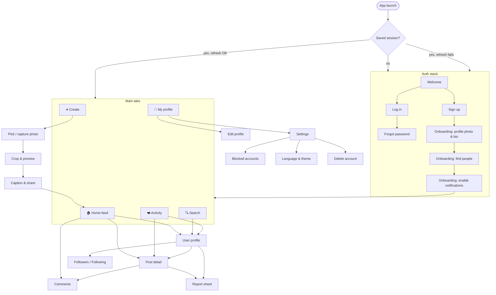
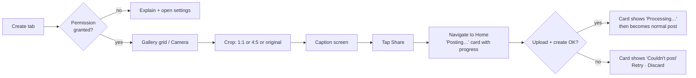
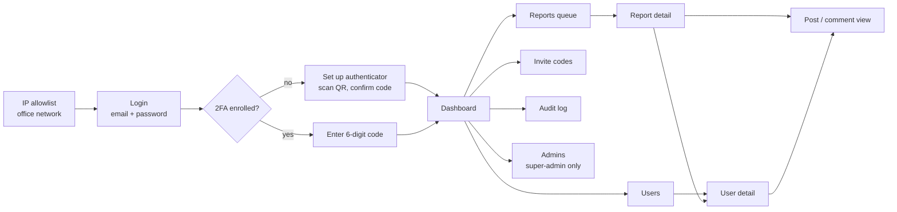

# Jamii Air — App Flow Document

| | |
|---|---|
| **Document** | 03 — App Flow |
| **Version** | 1.2 (Phase 2 API review: change password, removed-post badge, admin onboarding by temporary password) |
| **Status** | **Approved** — 2026-10-11 |
| **Date** | 2026-10-09 |
| **Scope** | Release 1 mobile app (Android & iOS) and admin portal (web, §15). R2 Reels flow sketched in §14. |
| **Related** | [01 BRS](01-business-requirements-specification.md) · [02 TRD](02-technical-requirements-document.md) · [04 Design Brief](04-design-brief.md) |

---

## 1. How to read this document

Each flow lists: **entry points → steps → system behaviour → states (loading / empty / error / offline) → exit**. Requirement IDs (BR-…) link to the BRS. API paths are relative to `/api/v1` (see TRD §5.1).

Universal rules applied to every screen:

| Rule | Behaviour |
|---|---|
| Navigation first, data second | Screen renders immediately with a skeleton; data loads after. Never block navigation on a request. |
| Loading | Skeletons shaped like the final content (not spinners) for lists; spinner only inside buttons. |
| Errors | Friendly, localised message mapped from `error.code` + "Try again" action. Never show raw codes or "Error 500". |
| Offline | Global banner "You're offline — showing saved content". Cached data stays visible; mutating actions are disabled or queued (likes). |
| Optimistic actions | Like, unlike, follow, unfollow, mark-read update instantly and roll back with a toast on failure. Delete, block, report wait for the server. |
| Session expiry | Access token refreshed silently. If refresh fails → return to Welcome with "Please log in again". |

## 2. Navigation map

**Bottom tabs (R1):** Home · Search · Create · Activity · Profile.
**R2:** Create moves to a header button on Home; a **Reels** tab takes the centre slot.

## 3. App launch & session restore

1. App starts → render native splash → render app shell immediately.
2. Read refresh token from secure storage.
   - None → **Welcome**.
   - Present → `POST /auth/refresh` (timeout 8 s).
     - Success → store new tokens → **Home**. Fetch `/me` and unread count in background.
     - `401` → clear tokens → **Welcome**.
     - Network error/timeout → open **Home** in offline mode with cached feed (if any) and retry refresh when connectivity returns.
3. If server returns `426 APP_VERSION_UNSUPPORTED` → blocking **Update required** screen with store link.

Startup must not wait for feed, profile or notification requests (Guidelines §25).

## 4. Authentication flows

### 4.1 Sign up (BR-AC-01, 02, 03, 06)

| Step | User | System |
|---|---|---|
| 1 | Taps **Create account** on Welcome. | Shows Sign-up form. |
| 2 | Enters invite code *(pilot only)*, email, username, password and **date of birth** (native date picker); ticks "I accept the Terms and Privacy Policy". | Inline validation as they type: username format & length; password ≥ 8; email format; date of birth shows "You must be 18 or older to use Jamii Air" if under 18 and disables **Create account**. The server re-checks age (never trust the client). Username availability is checked on submit only (no per-keystroke API calls). |
| 3 | Taps **Create account**. | `POST /auth/register`. Button shows spinner, form disabled. |
| 4a | — | **Success** → tokens stored → **Onboarding 1**. |
| 4b | — | `USERNAME_TAKEN` / `EMAIL_TAKEN` → error under the field. `INVITE_INVALID` → error under invite field. `UNDER_MINIMUM_AGE` → "You must be 18 or older to use Jamii Air." `RATE_LIMITED` → "Too many attempts, try again in a few minutes." |

### 4.2 Onboarding (first session only)

1. **Profile photo & bio** — optional; *Skip* always visible. Avatar uses the upload flow (§6.1) with `purpose: AVATAR`.
2. **Find people** — search field + list of other pilot users (all users during pilot, newest first) with **Follow** buttons. Shows "Follow at least 1 person to fill your feed" hint. *Continue* always enabled. (Drives KPI: % new users who follow.)
3. **Notifications** — explain value ("Know when friends like your posts") → **Turn on** triggers OS permission prompt → on grant, register token `PUT /me/devices/:installationId`. *Not now* allowed; can enable later in Settings.
4. → **Home**.

### 4.3 Log in

Identifier field accepts email **or** username + password → `POST /auth/login`.
- Success → **Home** (skip onboarding).
- `INVALID_CREDENTIALS` → "Incorrect username/email or password" (never reveals which).
- `ACCOUNT_SUSPENDED` → "Your account is suspended. Contact support@…".
- `ACCOUNT_PENDING_DELETION` → dialog "Your account is scheduled for deletion on {date}. Log in to cancel deletion?" → **Cancel deletion** restores the account.

### 4.4 Forgot password (BR-AC-07, *Should*)

Enter email → `POST /auth/password/forgot` → always shows "If an account exists, we've sent a 6-digit code" → enter code + new password → `POST /auth/password/reset` → success → **Log in** (all other sessions revoked).

### 4.5 Log out

Settings → **Log out** → confirm → `DELETE /me/devices/:installationId` (best effort) → `POST /auth/logout` → clear secure storage, clear TanStack Query cache → **Welcome**. Works offline: local data is always cleared; if the server call fails, the refresh token simply expires unused (it is no longer on the device).

## 5. Home feed (BR-FD-01, 02, 07)

**Entry:** Home tab, app launch, tapping Home tab again scrolls to top (double tap: scroll to top + refresh).

| Step | Behaviour |
|---|---|
| Load | `GET /feed?limit=20` → render with FlashList. Image space reserved from `width/height` (no layout shift); blurhash placeholder until image loads. |
| Scroll | When 5 items from the end → `GET /feed?cursor=…`. Footer skeleton while loading. `nextCursor = null` → "You're all caught up ✓" footer. |
| Refresh | Pull-to-refresh → refetch first page; new posts appear on top. |
| Own new post | While the user's new post is `PROCESSING`, a local card with the preview and "Posting…" sits at the top; it's replaced by the server version when published. |

**Post card contents:** avatar + username (→ profile) · ⋯ menu · photo · ❤️ like, 💬 comment, ↗ share · like count · caption (2 lines, "more" expands) · "View all N comments" (→ comments) · relative time.

**⋯ menu:** own post → *Delete*, *Copy link*. Others' post → *Report*, *Copy link*, *Unfollow*, *Block*.

**States**

| State | UI |
|---|---|
| First load | 3 skeleton post cards. |
| Empty (follows nobody / no posts) | Illustration + "Your feed is empty. Follow people to see their posts." + **Find people** (→ Search) + **Share your first photo** (→ Create). |
| Error (no cache) | "Couldn't load your feed." + **Try again**. |
| Error (with cache) | Keep cached content; toast "Couldn't refresh". |
| Offline | Offline banner; cached pages shown; pagination paused. |

## 6. Create post (BR-CT-01 – 03, 06)

### 6.1 Upload sequence (shared by posts and avatar)

1. Client downscales to ≤ 2048 px long edge, JPEG quality 85, removes nothing else (server strips metadata).
2. `POST /media/uploads { kind: IMAGE, mimeType, byteSize, purpose }` → `{ mediaId, uploadUrl, headers }`.
3. `PUT uploadUrl` with progress events. On network failure: automatic retry ×3 with backoff; then show **Retry**.
4. If the upload intent has expired (> 15 min, e.g. app was backgrounded) → request a new intent transparently.
5. Posts: `POST /posts { mediaIds:[mediaId], caption }` with an `Idempotency-Key` generated once per draft. Avatar: `PATCH /me { avatarMediaId }`.
6. Server returns `PROCESSING`. Client polls `GET /posts/:id` at 2 s, 4 s, 8 s (max 5 tries) until `PUBLISHED` or `FAILED`. (Push is not used for this; polling is short and bounded.)

**Draft persistence:** the selected local file URI, crop and caption are saved locally until the post is published, so a crash or app kill doesn't lose the post. On next launch: "You have an unfinished post — Retry / Discard".

**Validation messages:** file > 15 MB → "This photo is too large"; unsupported format → "This file type isn't supported"; server `MEDIA_INVALID` → "We couldn't process this photo. Try another one."

## 7. Post engagement

### 7.1 Like (BR-FD-03)

Tap ❤️ or double-tap photo → heart animation + count +1 immediately → `PUT /posts/:id/like`. Failure → revert + toast "Couldn't like post". Rapid toggling is debounced: only the final state is sent (300 ms). Only the affected card re-renders.

### 7.2 Comments (BR-FD-04, 05)

**Entry:** 💬 icon, "View all comments", notification.
- Comments screen: post caption pinned at top; list oldest → newest, paginated (`GET /posts/:id/comments`), loads more on scroll up/down as designed; input bar fixed above keyboard.
- **Send:** comment appears immediately in a "sending" style → `POST /posts/:id/comments` → confirmed. Failure → red "Not sent · Tap to retry".
- **Delete:** long-press own comment (or any comment on own post) → *Delete* → confirm → `DELETE /comments/:id` → removed.
- **Report:** long-press others' comment → *Report*.
- Max 1,000 chars; counter shows from 900.
- Blocked relationship → input hidden; message "You can't comment on this post".

### 7.3 Share (BR-FD-06)

Tap ↗ → OS share sheet with text "{username} on Jamii Air: {shareUrl}". Analytics `share_tapped`. *Copy link* in ⋯ menu copies `shareUrl` + toast "Link copied".

### 7.4 Delete own post (BR-CT-04)

⋯ → *Delete* → confirm dialog "Delete this post? This can't be undone." → `DELETE /posts/:id` → removed from feed/profile caches → toast "Post deleted".

## 8. Search & profiles

### 8.1 Search (BR-PR-03)

Search tab → input autofocus → debounce 300 ms, min 1 char → `GET /users/search?q=` → list of avatar · username · display name. Previous request cancelled when typing continues. Empty query shows **Recent searches** (stored locally, max 10, clearable). No results → "No accounts found for '{q}'".

### 8.2 User profile (BR-PR-01, 04, 05)

Header: avatar, display name, username, bio, counts (posts · followers · following). Button: **Follow** / **Following** (tap → confirm sheet "Unfollow @x?") . ⋯ → *Report*, *Block*, *Copy profile link*.
Body: 3-column grid of `thumb` images (FlashList, paginated). Tap → Post detail.
Followers/Following counts → list screens with follow buttons.
Empty grid → "No posts yet".
Blocked/not found → "This account isn't available" (same message for both).

### 8.3 My profile

Same layout; button **Edit profile**; ⚙ → Settings. Own `PROCESSING` posts show with a small "processing" overlay.

### 8.4 Edit profile (BR-PR-02)

Fields: photo (change/remove), display name (≤ 50), username (3–30, availability checked on save), bio (≤ 160). **Save** → `PATCH /me` → back. Unsaved changes + back → "Discard changes?".

## 9. Activity / notifications (BR-NT-01 – 04)

- Tab badge = unread count (`GET /notifications/unread-count` on app foreground, on push receipt, and after visiting Activity).
- Activity list grouped **New** / **Earlier**: "amina liked your post" (+ thumb), "baraka commented: 'nice!'" (+ thumb), "neema started following you" (+ Follow back button).
- Opening the tab marks visible items read (`POST /notifications/read { all: true }`) after 1 s.
- Tap row → Post detail (like/comment) or Profile (follow). Target deleted/hidden → toast "This post is no longer available".

### 9.1 Push notification handling

| App state | Behaviour |
|---|---|
| Foreground | No system banner; in-app toast at top + badge increment. |
| Background / killed | System notification. Tap → app opens directly to the target (post or profile) with Home tab underneath in the back stack. |
| Logged out | Device token was deleted on logout; nothing delivered. |

## 10. Safety flows

### 10.1 Block (BR-SF-01)

Profile/post ⋯ → *Block @x* → sheet: "They won't be able to see your profile or posts, or interact with you. They won't be notified." → **Block** → `PUT /users/:id/block` → their posts vanish from feed cache; profile shows "You blocked this account · Unblock". Unblock via profile or Settings → Blocked accounts. Unblock does **not** restore previous follows.

### 10.2 Report (BR-SF-02)

⋯ → *Report* → bottom sheet reasons: Spam · Nudity or sexual content · Harassment or bullying · Hate speech · Violence · False information · Something else (+ optional details ≤ 1,000) → **Submit** → `POST /reports` → "Thanks — we'll review this." + offer **Block @x**. Duplicate reports from the same user on the same target are accepted silently.

### 10.3 What happens after a report

Reports are handled by admins in the **separate admin portal** (§15). The mobile app has no admin screens. The reporting user gets no status updates in R1; the reported user is never told who reported them. Content hidden by an admin disappears for everyone; on the author's own profile grid it shows as "Removed for violating Community Guidelines".

### 10.4 Delete account (BR-AC-08)

Settings → **Delete account** → explanation (what is deleted, 30-day grace, how to cancel) → re-enter password → **Delete my account** → `DELETE /me` → logged out → Welcome with "Your account is scheduled for deletion". Logging in within 30 days offers to cancel (§4.3).

## 11. Settings

Account: Edit profile · Change password *(S)* · Notifications (system permission status + link) · Language (System / English / Kiswahili) · Theme (System / Light / Dark) · Blocked accounts · Terms · Privacy Policy · Contact support · App version · **Log out** · **Delete account**.

## 12. Deep links

| Link | Opens | Not logged in |
|---|---|---|
| `https://<domain>/p/{postId}` | Post detail | Welcome → after login, opens the post |
| `https://<domain>/u/{username}` | User profile | Same as above |
| `jamiiair://p/{postId}` | Post detail (dev / fallback) | Same |
| App not installed | Web landing page → store links | — |

Pending deep link is stored during auth and resumed after login/onboarding.

## 13. Error & edge-case catalogue

| Situation | Behaviour |
|---|---|
| Post deleted while viewing | Detail shows "This post is no longer available"; removed from caches. |
| Like on deleted post (`404`) | Revert optimistic like silently; remove post from feed. |
| Rate limited (`429`) | "You're doing that too fast. Try again in a moment." Retry-After respected. |
| Server error (`5xx`) | "Something went wrong on our side. Try again." + automatic retry ×2 for GETs only. |
| Timeout (> 15 s GET, > 60 s upload chunk) | Treated as network error. |
| Suspended mid-session (`403 ACCOUNT_SUSPENDED`) | Logout + explanation screen. |
| App backgrounded during upload | Upload continues while OS allows; on resume, failed uploads show Retry; expired intents renewed automatically. |
| Low storage / permission denied | Explain and link to settings; never crash. |

## 14. Release 2 preview — Reels flow (not in R1)

- **Reels tab:** full-screen vertical pager; one video plays at a time, muted by default until the user taps sound; preloads next 2 videos at low rendition; pauses when off-screen or app backgrounded.
- **Create Reel:** record (≤ 60 s) or pick video → trim → cover frame → caption → upload (same upload-intent flow with `kind: VIDEO`, resumable multipart) → "Processing…" while transcoding.
- **Engagement:** same like / comment / share / report components as photo posts.
- **Data-saver:** on cellular, autoplay uses 360p; "Data saver" setting disables autoplay.

## 15. Admin portal flows (web, separate from the mobile app)

The admin portal is a desktop web app at `admin.<domain>` (TRD §8). Admins have **separate accounts** from app users. All pages require an admin session; every mutating action asks for a reason note and is audit-logged.

### 15.1 Portal map

Layout: left sidebar (Dashboard · Reports *(open count badge)* · Users · Invite codes · Audit log · Admins), top bar with admin name, role and **Log out**.

### 15.2 Sign in

1. The portal only opens from allowlisted IP addresses (office network); other addresses get an access-denied page.
2. **Login:** email + password → `POST /admin/auth/login`. Wrong credentials → generic "Incorrect email or password"; 10 consecutive failures lock the account (super-admin unlocks).
3. **First login:** forced 2FA enrollment — QR code + manual key → enter code to confirm → session starts.
4. **Later logins:** enter 6-digit TOTP code → session starts.
5. Session ends after 30 min idle (warning at 25 min with **Stay signed in**) or 12 h total → back to Login with "Your session expired".

### 15.3 Dashboard

KPI cards (from `daily_metrics`): registered users, DAU, new sign-ups, posts / likes / comments / follows today, D1 / D7 / D30 retention, % new users who followed someone, % who posted. Plus **Open reports** (with oldest age), **Suspended users**, **Invite codes remaining**. Date range selector (7 / 30 / 90 days) with simple trend lines.

### 15.4 Handle a report (BR-SF-02…05)

| Step | Admin | System |
|---|---|---|
| 1 | Opens **Reports** (default filter: Open, oldest first; filters: status, type, reason). | `GET /admin/reports` |
| 2 | Clicks a report. | Detail page: reported content preview (image + caption / comment text / profile), content status, reporter, reason, details, **other reports on the same target**, the reported user's previous moderation history. Report moves to `REVIEWING` when opened. |
| 3a | **Hide post / comment** → reason note → confirm. | `POST /admin/posts/:id/hide` → content disappears for all app users; action logged; report can be marked Resolved in the same dialog. |
| 3b | **Suspend user** → reason note → confirm ("This logs them out and hides their content"). | `POST /admin/users/:id/suspend` → sessions revoked, content hidden, user sees suspension message on next request. |
| 3c | **Dismiss** → note. | Report `DISMISSED`; no content change. |
| 4 | — | Toast "Report resolved"; returns to queue at the next oldest report. |

Undo: hidden content can be **Unhidden** and suspended users **Reinstated** from their detail pages (note required, logged).

### 15.5 Users

Search by username, display name or email; filter by status. **User detail:** profile header, status, joined date, age confirmed (18+ — DOB itself not displayed), counts, recent posts grid (incl. hidden, badged), reports against them, moderation history, active sessions count. Actions: **Suspend / Reinstate**, **Revoke all sessions**.

### 15.6 Invite codes (pilot)

List (code, created by, uses / max, expiry, status). **Create**: number of uses, expiry → code shown with **Copy**. **Revoke** an unused code. Used-by list per code.

### 15.7 Audit log

Read-only, newest first, filterable by admin, action type, target and date. Every row: when, who, action, target (link), note.

### 15.8 Admins (super-admin only)

List admins with role and last login. **Add admin** (email, name, role) → a **one-time temporary password** shown once, to hand over securely; the new admin sets up 2FA at first sign-in, then changes the password (account menu → *Change password*). **Change role**, **Disable** (re-enabling also unlocks a locked account), **Reset 2FA** (forces re-enrollment). Super-admins cannot demote or disable themselves.

### 15.9 Portal states

| State | Behaviour |
|---|---|
| Loading | Table skeleton rows. |
| Empty queue | "No open reports 🎉". |
| Error | Inline banner with Retry; mutations never fail silently. |
| Permission denied (moderator on super-admin page) | "You don't have access to this page." |
| Concurrent edit (another admin already resolved) | `409` → "This report was already handled by {admin}" + refresh. |
