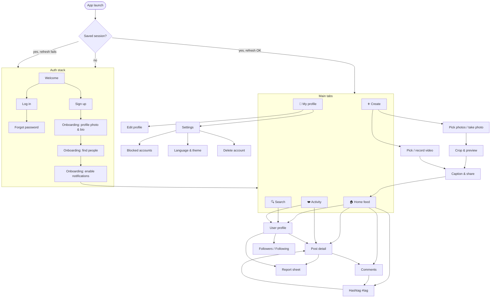
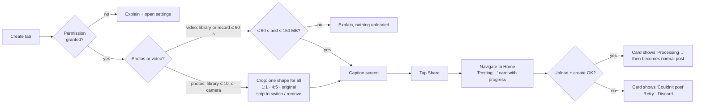
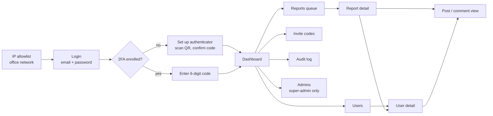
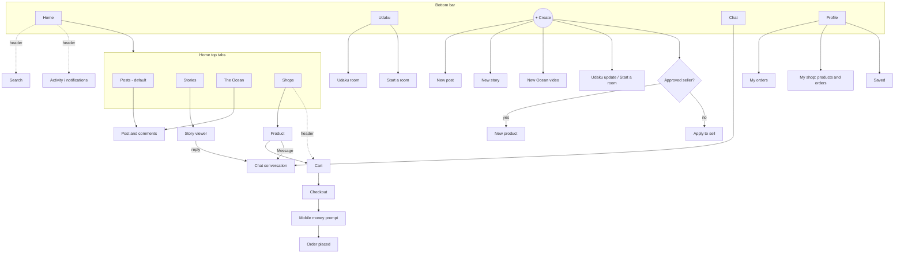

# Jamii Air — App Flow Document

| | |
|---|---|
| **Document** | 03 — App Flow |
| **Version** | 1.5 (2026-10-31, BRS §6.3: the app becomes **Kidili** — new navigation, Stories, The Ocean, Udaku rooms, Chat, Shops and the matching admin pages, all in §16) · 1.4 (2026-10-27, BRS §6.2: Sign in with Google §4.6, private accounts §8.2a, follow requests §8.5, Activity §9, Settings §11, delete account for a Google-only account §10.4) · 1.3 (R1 scope change 2026-10-16, BRS §6.1: carousels and video in §5–§6, replies §7.2, hashtags §7.5, a post on screen the moment it is shared §5) · 1.2 (Phase 2 API review: change password, removed-post badge, admin onboarding by temporary password) |
| **Status** | **Approved** — 2026-10-11 |
| **Date** | 2026-10-09 |
| **Scope** | Release 1 mobile app (Android & iOS) and admin portal (web, §15). R2 Reels flow sketched in §14. |
| **Related** | [01 BRS](01-business-requirements-specification.md) · [02 TRD](02-technical-requirements-document.md) · [04 Design Brief](04-design-brief.md) |

---

## 1. How to read this document

Each flow lists: **entry points → steps → system behaviour → states (loading / empty / error / offline) → exit**. Requirement IDs (BR-…) link to the BRS. API paths are relative to `/api/v1` (see TRD §5.1).

Universal rules applied to every screen:

| Rule | Behaviour |
|---|---|
| Navigation first, data second | Screen renders immediately with a skeleton; data loads after. Never block navigation on a request. |
| Loading | Skeletons shaped like the final content (not spinners) for lists; spinner only inside buttons. |
| Errors | Friendly, localised message mapped from `error.code` + "Try again" action. Never show raw codes or "Error 500". |
| Offline | Global banner "You're offline — showing saved content". Cached data stays visible; mutating actions are disabled or queued (likes). |
| Optimistic actions | Like, unlike, follow, unfollow, mark-read update instantly and roll back with a toast on failure. Delete, block, report wait for the server. |
| Session expiry | Access token refreshed silently. If refresh fails → return to Welcome with "Please log in again". |

## 2. Navigation map

**Bottom tabs (R1):** Home · Search · Create · Activity · Profile.
**Kidili (BRS §6.3, from Plan task K1):** Home · Udaku · **+** · Chat · Profile, with Home's top
tabs Posts · Stories · The Ocean · Shops, and Search and Activity in Home's header — see §16.1.
The R2 Reels tab is replaced by The Ocean.

## 3. App launch & session restore

1. App starts → render native splash → render app shell immediately.
2. Read refresh token from secure storage.
   - None → **Welcome**.
   - Present → `POST /auth/refresh` (timeout 8 s).
     - Success → store new tokens → **Home**. Fetch `/me` and unread count in background.
     - `401` → clear tokens → **Welcome**.
     - Network error/timeout → open **Home** in offline mode with cached feed (if any) and retry refresh when connectivity returns.
3. If server returns `426 APP_VERSION_UNSUPPORTED` → blocking **Update required** screen with store link.

Startup must not wait for feed, profile or notification requests (Guidelines §25).

## 4. Authentication flows

### 4.1 Sign up (BR-AC-01, 02, 03, 06)

| Step | User | System |
|---|---|---|
| 1 | Taps **Create account** on Welcome. | Shows Sign-up form. |
| 2 | Enters invite code *(pilot only)*, email, username, password and **date of birth** (native date picker); ticks "I accept the Terms and Privacy Policy". | Inline validation as they type: username format & length; password ≥ 8; email format; date of birth shows "You must be 18 or older to use Jamii Air" if under 18 and disables **Create account**. The server re-checks age (never trust the client). Username availability is checked on submit only (no per-keystroke API calls). |
| 3 | Taps **Create account**. | `POST /auth/register`. Button shows spinner, form disabled. |
| 4a | — | **Success** → tokens stored → **Onboarding 1**. |
| 4b | — | `USERNAME_TAKEN` / `EMAIL_TAKEN` → error under the field. `INVITE_INVALID` → error under invite field. `UNDER_MINIMUM_AGE` → "You must be 18 or older to use Jamii Air." `RATE_LIMITED` → "Too many attempts, try again in a few minutes." |

### 4.2 Onboarding (first session only)

1. **Profile photo & bio** — optional; *Skip* always visible. Avatar uses the upload flow (§6.1) with `purpose: AVATAR`.
2. **Find people** — search field + list of other pilot users (all users during pilot, newest first) with **Follow** buttons. Shows "Follow at least 1 person to fill your feed" hint. *Continue* always enabled. (Drives KPI: % new users who follow.)
3. **Notifications** — explain value ("Know when friends like your posts") → **Turn on** triggers OS permission prompt → on grant, register token `PUT /me/devices/:installationId`. *Not now* allowed; can enable later in Settings.
4. → **Home**.

### 4.3 Log in

Identifier field accepts email **or** username + password → `POST /auth/login`.
- Success → **Home** (skip onboarding).
- `INVALID_CREDENTIALS` → "Incorrect username/email or password" (never reveals which).
- `ACCOUNT_SUSPENDED` → "Your account is suspended. Contact support@…".
- `ACCOUNT_PENDING_DELETION` → dialog "Your account is scheduled for deletion on {date}. Log in to cancel deletion?" → **Cancel deletion** restores the account.

### 4.4 Forgot password (BR-AC-07, *Should*)

Enter email → `POST /auth/password/forgot` → always shows "If an account exists, we've sent a 6-digit code" → enter code + new password → `POST /auth/password/reset` → success → **Log in** (all other sessions revoked).

### 4.5 Log out

Settings → **Log out** → confirm → `DELETE /me/devices/:installationId` (best effort) → `POST /auth/logout` → clear secure storage, clear TanStack Query cache → **Welcome**. Works offline: local data is always cleared; if the server call fails, the refresh token simply expires unused (it is no longer on the device).

### 4.6 Continue with Google (BR-AC-09…11)

Welcome and Log in both show **Continue with Google**. Tapping it opens Google's own account
chooser (the native one, not a browser page) → the app sends the ID token to `POST /auth/google`.

| Result | App |
|---|---|
| A Jamii Air account is connected to this Google account | Signed in → **Home** (suspended, pending deletion: as §4.3) |
| No account, and the Google email is not in use | **Finish signing up**: username (suggested from the Google name, editable), date of birth, Terms checkbox — **no invite code** (D-13) → `POST /auth/google` again with those → **Onboarding 1** (photo pre-filled from Google is *not* used; the user picks one, as §4.2) |
| No connected account, but the email belongs to an account | "An account with {email} already exists. Log in with your password, then connect Google in Settings → Account." → **Log in** with the email filled in. Google never takes over an account silently (BR-AC-10) |
| The user closes the chooser | Nothing happens; no error |
| No Google Play services, no network | "Google sign-in isn't available right now. Use your email and password." |

## 5. Home feed (BR-FD-01, 02, 07)

**Entry:** Home tab, app launch, tapping Home tab again scrolls to top (double tap: scroll to top + refresh).

| Step | Behaviour |
|---|---|
| Load | `GET /feed?limit=20` → render with FlashList. Image space reserved from `width/height` (no layout shift); blurhash placeholder until image loads. |
| Scroll | When 5 items from the end → `GET /feed?cursor=…`. Footer skeleton while loading. `nextCursor = null` → "You're all caught up ✓" footer. |
| Refresh | Pull-to-refresh → refetch first page; new posts appear on top. |
| Own new post | While the files upload, a local card with the preview and "Posting… N%" sits at the top. **As soon as `POST /posts` returns**, the feed is refetched and the post itself is in it, still `PROCESSING`, holding its place with "Processing…" (the feed returns the viewer's own processing posts, BR-FD-12); it fills in when published, and the feed returns to the top so it is what the user is looking at. *(Changed 2026-10-16: before, the feed only returned PUBLISHED posts, so a refresh after sharing showed exactly what was already there and the post appeared only on some later refresh — for a video, for as long as transcoding took.)* |

**Post card contents:** avatar + username (→ profile) · ⋯ menu · media · ❤️ like, 💬 comment, ↗ share · like count · caption (2 lines, "more" expands; **#tags tappable**, §7.5) · "View all N comments" (→ comments) · relative time.

**Media** (BR-CT-07/09):

| Post | Shown as |
|---|---|
| One photo | Full-bleed, aspect reserved (4:5…1.91:1); double-tap likes. |
| 2–10 photos | Horizontal pager, one photo per page, all pages the height of the first; "2/5" counter top-right and dots below. Double-tap is off (a swipe must stay a swipe): like with ❤️. |
| Video | Poster, ▶ button and length ("0:42"). **No autoplay** — it would spend a prepaid bundle on posts nobody chose to watch. Tap → plays muted, looped, fitted (a 9:16 clip is letterboxed, not cropped); 🔇/🔊 control to unmute. |

Profile and hashtag grids badge a video tile with ▶ and a carousel tile with a stack icon, and announce them as such to a screen reader.

**⋯ menu:** own post → *Delete*, *Copy link*. Others' post → *Report*, *Copy link*, *Unfollow*, *Block*.

**States**

| State | UI |
|---|---|
| First load | 3 skeleton post cards. |
| Empty (follows nobody / no posts) | Illustration + "Your feed is empty. Follow people to see their posts." + **Find people** (→ Search) + **Share your first photo** (→ Create). |
| Error (no cache) | "Couldn't load your feed." + **Try again**. |
| Error (with cache) | Keep cached content; toast "Couldn't refresh". |
| Offline | Offline banner; cached pages shown; pagination paused. |

## 6. Create post (BR-CT-01 – 03, 06 – 10)

The Create tab offers **Choose from library** (up to 10 photos, in the order picked, BR-CT-09), **Take a photo**, **Choose a video** and **Record a video** (BR-CT-07). A post is photos *or* one video, never both (BR-CT-10).

- **Crop (photos):** one shape applies to the whole carousel, so its pages line up. Each photo keeps its own drag position; a strip under the frame switches photos ("Photo 2 of 3") and ✕ removes one (removing the last one leaves the flow). Changing the shape recentres every photo.
- **Video:** no crop step — it goes straight to the caption, whose preview shows the first frame and the length. Too long (> 60 s) or too large (> 150 MB) is refused **before** anything is uploaded, with the reason.
- **Caption:** a carousel shows its photos in order as a strip.

### 6.1 Upload sequence (shared by posts and avatar)

1. Client downscales to ≤ 2048 px long edge, JPEG quality 85, removes nothing else (server strips metadata).
2. `POST /media/uploads { kind: IMAGE, mimeType, byteSize, purpose }` → `{ mediaId, uploadUrl, headers }`.
3. `PUT uploadUrl` with progress events. On network failure: automatic retry ×3 with backoff; then show **Retry**.
4. If the upload intent has expired (> 15 min, e.g. app was backgrounded) → request a new intent transparently.
5. Posts: one intent + PUT **per file**, in order, under one progress bar ("Posting… 45%" across all of them); a file already uploaded is not uploaded again on Retry. Then `POST /posts { mediaIds:[…], caption }` with an `Idempotency-Key` generated once per draft. Avatar: `PATCH /me { avatarMediaId }`.
6. Server returns `PROCESSING`. The client **refreshes the feed at once** (the post appears with "Processing…", §5), then polls `GET /posts/:id` until `PUBLISHED` or `FAILED`: photos at 2, 4, 8, 8, 8, 8 s (~40 s); a video at 4 s → 30 s steps (~2.5 min), since it is a transcode. (Push is not used for this; polling is bounded.)
7. A video skips step 1: it is uploaded as recorded (`kind: VIDEO`, `video/mp4` or `video/quicktime`) and the server re-encodes it (TRD §9.1).

**Draft persistence:** the selected local file URI, crop and caption are saved locally until the post is published, so a crash or app kill doesn't lose the post. On next launch: "You have an unfinished post — Retry / Discard".

**Validation messages:** file > 15 MB → "This photo is too large"; unsupported format → "This file type isn't supported"; server `MEDIA_INVALID` → "We couldn't process this photo. Try another one."; more than 10 photos picked → the first 10 are kept, with a note; video > 60 s → "Video too long"; video > 150 MB → "Video too large"; `MEDIA_KINDS_MIXED` → "A post can hold photos or one video, not both."

## 7. Post engagement

### 7.1 Like (BR-FD-03)

Tap ❤️ or double-tap photo → heart animation + count +1 immediately → `PUT /posts/:id/like`. Failure → revert + toast "Couldn't like post". Rapid toggling is debounced: only the final state is sent (300 ms). Only the affected card re-renders.

### 7.2 Comments and replies (BR-FD-04, 05, 08, 09)

**Entry:** 💬 icon, "View all comments", notification.
- Comments screen: post caption pinned at top; list **newest first**, paginated (`GET /posts/:id/comments`, which pages newest-first anyway), older ones load on scrolling down; input bar fixed above the keyboard. Sending scrolls back to the top, so the comment just written is the one on screen rather than the end of a long thread. *(Changed 2026-10-16 after the first real use: it ran oldest → newest in a chat-style inverted list, and a new comment landed out of sight.)*
- **Send:** comment appears immediately in a "sending" style → `POST /posts/:id/comments` → confirmed. Failure → red "Not sent · Tap to retry".
- **Replies (BR-FD-08/09):** each comment has **Reply** beside its time. Replies sit indented under their comment, collapsed behind "View N replies"; opening loads the thread **oldest first** (`GET /comments/:id/replies`), "More replies" pages it, "Hide replies" closes it. **Reply** puts "Replying to <username> · Cancel" above the input and the placeholder becomes "Reply to <username>…"; sending posts with `parentId` and the reply joins the thread. Replies are one level deep: **Reply** on a reply answers the same parent comment. A reply notifies the author of the comment it answers, not the post's author.
- **Delete:** long-press own comment (or any comment on own post) → *Delete* → confirm → `DELETE /comments/:id` → removed. A comment that has replies asks "Delete comment and its replies?" — the thread goes with it.
- **Report:** long-press others' comment → *Report*.
- Max 1,000 chars; counter shows from 900.
- Blocked relationship → input hidden; message "You can't comment on this post".

### 7.3 Share (BR-FD-06)

Tap ↗ → OS share sheet with text "{username} on Jamii Air: {shareUrl}". Analytics `share_tapped`. *Copy link* in ⋯ menu copies `shareUrl` + toast "Link copied".

### 7.4 Delete own post (BR-CT-04)

⋯ → *Delete* → confirm dialog "Delete this post? This can't be undone." → `DELETE /posts/:id` → removed from feed/profile caches → toast "Post deleted".

### 7.5 Hashtags (BR-FD-10/11)

A `#tag` in a caption or a comment is drawn in the primary colour and is tappable (the same rule the server stores by: `#` + 1–64 letters, digits or `_`, not straight after one of those — `C#` is not a tag). Tapping opens **`/t/<tag>`**: "#tag" header, "N posts", and a 3-column grid newest first (`GET /tags/:tag/posts`). Posts from people the user does not follow are included — a tag is how people are found — but nothing hidden, blocked either way, or by a suspended author. No posts → "Nothing here yet". Editing a tag out of a caption takes the post off that tag.

## 8. Search & profiles

### 8.1 Search (BR-PR-03)

Search tab → input autofocus → debounce 300 ms, min 1 char → `GET /users/search?q=` → list of avatar · username · display name. Previous request cancelled when typing continues. Empty query shows **Recent searches** (stored locally, max 10, clearable). No results → "No accounts found for '{q}'".

### 8.2 User profile (BR-PR-01, 04, 05)

Header: avatar, display name, username, bio, counts (posts · followers · following). Button: **Follow** / **Following** (tap → confirm sheet "Unfollow @x?"); **Follow back** when they follow you and you don't follow them. ⋯ → *Report*, *Block*, *Copy profile link*.
Body: 3-column grid of `thumb` images (FlashList, paginated). Tap → Post detail.
Followers/Following counts → list screens with follow buttons.
Empty grid → "No posts yet".
Blocked/not found → "This account isn't available" (same message for both).

### 8.2a A private account (BR-PR-06…09)

Seen by someone who is not an approved follower: the header as above (avatar, names, bio, counts),
then a lock and "This account is private · Follow to see their photos and videos" in place of the
grid. The follower and following counts are not tappable. The button reads:

| State | Button | Tap |
|---|---|---|
| Not following | **Follow** | `PUT /users/:id/follow` → `REQUESTED` → button becomes **Requested** |
| Request pending | **Requested** | Sheet "Cancel follow request?" → `DELETE /users/:id/follow` → **Follow** |
| Approved follower | **Following** | as §8.2; unfollowing a private account means asking again to come back |

The same applies wherever a Follow button is shown (search results, follower lists, onboarding
Find people, Activity Follow back). A post from a private account that the viewer cannot see —
an old share link, a stale notification — opens as "This post isn't available", the same
message as a deleted one. Its posts never appear on hashtag pages for non-followers.

### 8.3 My profile

Same layout; button **Edit profile**; ⚙ → Settings. Own `PROCESSING` posts show with a small "processing" overlay.

### 8.4 Edit profile (BR-PR-02)

Fields: photo (change/remove), display name (≤ 50), username (3–30, availability checked on save), bio (≤ 160). **Save** → `PATCH /me` → back. Unsaved changes + back → "Discard changes?".

### 8.5 Follow requests (BR-PR-07)

My profile of a private account, and the top of Activity, show **Follow requests · {n}** when
there are any → list of requesters, newest first: avatar, username, display name, **Confirm**
and **Delete**. Confirm → `POST /me/follow-requests/:userId/accept` → the row becomes "now
follows you" with **Follow back**. Delete → `DELETE /me/follow-requests/:userId` → row goes; the
requester is not told. Empty → "No follow requests".

My own followers list has **Remove** on each row in place of the Follow button → confirm
"Remove @x? They won't be told that you removed them." → `DELETE /me/followers/:userId` (BR-PR-09).

## 9. Activity / notifications (BR-NT-01 – 04)

- Tab badge = unread count (`GET /notifications/unread-count` on app foreground, on push receipt, and after visiting Activity).
- Activity list grouped **New** / **Earlier**: "amina liked your post" (+ thumb), "baraka commented: 'nice!'" (+ thumb), "juma replied to your comment" (+ thumb), "neema started following you" (+ Follow back button), "neema asked to follow you" (tap → Follow requests), "neema accepted your follow request" (tap → their profile).
- A private account with pending requests sees a **Follow requests · {n}** row above the list (§8.5). Accepting or declining a request removes its "asked to follow you" row.
- Opening the tab marks visible items read (`POST /notifications/read { all: true }`) after 1 s.
- Tap row → Post detail (like/comment) or Profile (follow). Target deleted/hidden → toast "This post is no longer available".

### 9.1 Push notification handling

| App state | Behaviour |
|---|---|
| Foreground | No system banner; in-app toast at top + badge increment. |
| Background / killed | System notification. Tap → app opens directly to the target (post or profile) with Home tab underneath in the back stack. |
| Logged out | Device token was deleted on logout; nothing delivered. |

## 10. Safety flows

### 10.1 Block (BR-SF-01)

Profile/post ⋯ → *Block @x* → sheet: "They won't be able to see your profile or posts, or interact with you. They won't be notified." → **Block** → `PUT /users/:id/block` → their posts vanish from feed cache; profile shows "You blocked this account · Unblock". Unblock via profile or Settings → Blocked accounts. Unblock does **not** restore previous follows.

### 10.2 Report (BR-SF-02)

⋯ → *Report* → bottom sheet reasons: Spam · Nudity or sexual content · Harassment or bullying · Hate speech · Violence · False information · Something else (+ optional details ≤ 1,000) → **Submit** → `POST /reports` → "Thanks — we'll review this." + offer **Block @x**. Duplicate reports from the same user on the same target are accepted silently.

### 10.3 What happens after a report

Reports are handled by admins in the **separate admin portal** (§15). The mobile app has no admin screens. The reporting user gets no status updates in R1; the reported user is never told who reported them. Content hidden by an admin disappears for everyone; on the author's own profile grid it shows as "Removed for violating Community Guidelines".

### 10.4 Delete account (BR-AC-08)

Settings → **Delete account** → explanation (what is deleted, 30-day grace, how to cancel) → re-enter password (an account with no password confirms with Google instead, BR-AC-11) → **Delete my account** → `DELETE /me` → logged out → Welcome with "Your account is scheduled for deletion". Logging in within 30 days offers to cancel (§4.3).

## 11. Settings

Account: Edit profile · **Private account** (switch; turning it on: "Only people you approve will see your photos and videos. Your current followers won't be affected." Turning it off: "Anyone will be able to see your posts, and your {n} pending requests will be accepted.") · **Follow requests** (when private) · Change password *(S)* (Set a password, for a Google-only account, goes through Forgot password) · **Google** (Connected as {email} / Connect, BR-AC-10) · Notifications (system permission status + link) · Language (System / English / Kiswahili) · Theme (System / Light / Dark) · Blocked accounts · Terms · Privacy Policy · Contact support · App version · **Log out** · **Delete account**.

## 12. Deep links

| Link | Opens | Not logged in |
|---|---|---|
| `https://<domain>/p/{postId}` | Post detail | Welcome → after login, opens the post |
| `https://<domain>/u/{username}` | User profile | Same as above |
| `jamiiair://p/{postId}` | Post detail (dev / fallback) | Same |
| App not installed | Web landing page → store links | — |

Pending deep link is stored during auth and resumed after login/onboarding.

## 13. Error & edge-case catalogue

| Situation | Behaviour |
|---|---|
| Post deleted while viewing | Detail shows "This post is no longer available"; removed from caches. |
| Like on deleted post (`404`) | Revert optimistic like silently; remove post from feed. |
| Rate limited (`429`) | "You're doing that too fast. Try again in a moment." Retry-After respected. |
| Server error (`5xx`) | "Something went wrong on our side. Try again." + automatic retry ×2 for GETs only. |
| Timeout (> 15 s GET, > 60 s upload chunk) | Treated as network error. |
| Suspended mid-session (`403 ACCOUNT_SUSPENDED`) | Logout + explanation screen. |
| App backgrounded during upload | Upload continues while OS allows; on resume, failed uploads show Retry; expired intents renewed automatically. |
| Low storage / permission denied | Explain and link to settings; never crash. |

## 14. Release 2 preview — Reels flow (not in R1)

*Since the 2026-10-16 scope change, recording or picking a video and posting it is R1 (§6). What remains here is the Reels **surface**.*
*Since 2026-10-31 (BRS §6.3) the vertical feed is R1 as **The Ocean** (§16.4); what stays in R2 below is trim, cover choice, resumable upload and the data-saver ladder.*

- **Reels tab:** full-screen vertical pager; one video plays at a time, muted by default until the user taps sound; preloads next 2 videos at low rendition; pauses when off-screen or app backgrounded.
- **Create Reel:** record (≤ 60 s) or pick video → trim → cover frame → caption → upload (same upload-intent flow with `kind: VIDEO`, resumable multipart) → "Processing…" while transcoding.
- **Engagement:** same like / comment / share / report components as photo posts.
- **Data-saver:** on cellular, autoplay uses 360p; "Data saver" setting disables autoplay.

## 15. Admin portal flows (web, separate from the mobile app)

The admin portal is a desktop web app at `admin.<domain>` (TRD §8). Admins have **separate accounts** from app users. All pages require an admin session; every mutating action asks for a reason note and is audit-logged.

### 15.1 Portal map

Layout: left sidebar (Dashboard · Reports *(open count badge)* · Users · Invite codes · Audit log · Admins), top bar with admin name, role and **Log out**.

### 15.2 Sign in

1. The portal only opens from allowlisted IP addresses (office network); other addresses get an access-denied page.
2. **Login:** email + password → `POST /admin/auth/login`. Wrong credentials → generic "Incorrect email or password"; 10 consecutive failures lock the account (super-admin unlocks).
3. **First login:** forced 2FA enrollment — QR code + manual key → enter code to confirm → session starts.
4. **Later logins:** enter 6-digit TOTP code → session starts.
5. Session ends after 60 min idle (warning at 55 min with **Stay signed in**) or 12 h total → back to Login with "Your session expired".

### 15.3 Dashboard

KPI cards (from `daily_metrics`): registered users, DAU, new sign-ups, posts / likes / comments / follows today, D1 / D7 / D30 retention, % new users who followed someone, % who posted. Plus **Open reports** (with oldest age), **Suspended users**, **Invite codes remaining**. Date range selector (7 / 30 / 90 days) with simple trend lines.

### 15.4 Handle a report (BR-SF-02…05)

| Step | Admin | System |
|---|---|---|
| 1 | Opens **Reports** (default filter: Open, oldest first; filters: status, type, reason). | `GET /admin/reports` |
| 2 | Clicks a report. | Detail page: reported content preview (image + caption / comment text / profile), content status, reporter, reason, details, **other reports on the same target**, the reported user's previous moderation history. Report moves to `REVIEWING` when opened. |
| 3a | **Hide post / comment** → reason note → confirm. | `POST /admin/posts/:id/hide` → content disappears for all app users; action logged; report can be marked Resolved in the same dialog. |
| 3b | **Suspend user** → reason note → confirm ("This logs them out and hides their content"). | `POST /admin/users/:id/suspend` → sessions revoked, content hidden, user sees suspension message on next request. |
| 3c | **Dismiss** → note. | Report `DISMISSED`; no content change. |
| 4 | — | Toast "Report resolved"; returns to queue at the next oldest report. |

Undo: hidden content can be **Unhidden** and suspended users **Reinstated** from their detail pages (note required, logged).

### 15.5 Users

Search by username, display name or email; filter by status. **User detail:** profile header, status, Public / Private (BR-PR-06; moderators see a private account's content all the same), joined date, age confirmed (18+ — DOB itself not displayed), counts, recent posts grid (incl. hidden, badged), reports against them, moderation history, active sessions count. Actions: **Suspend / Reinstate**, **Revoke all sessions**.

### 15.6 Invite codes (pilot)

List (code, created by, uses / max, expiry, status). **Create**: number of uses, expiry → code shown with **Copy**. **Revoke** an unused code. Used-by list per code.

### 15.7 Audit log

Read-only, newest first, filterable by admin, action type, target and date. Every row: when, who, action, target (link), note.

### 15.8 Admins (super-admin only)

List admins with role and last login. **Add admin** (email, name, role) → a **one-time temporary password** shown once, to hand over securely; the new admin sets up 2FA at first sign-in, then changes the password (account menu → *Change password*). **Change role**, **Disable** (re-enabling also unlocks a locked account), **Reset 2FA** (forces re-enrollment). Super-admins cannot demote or disable themselves.

### 15.9 Portal states

| State | Behaviour |
|---|---|
| Loading | Table skeleton rows. |
| Empty queue | "No open reports 🎉". |
| Error | Inline banner with Retry; mutations never fail silently. |
| Permission denied (moderator on super-admin page) | "You don't have access to this page." |
| Concurrent edit (another admin already resolved) | `409` → "This report was already handled by {admin}" + refresh. |

## 16. Kidili (BRS §6.3, 2026-10-31)

The app becomes **Kidili** (D-14). This section is the flow for everything §6.3 adds or moves. Where
it conflicts with §2–§15, **§16 wins once Plan task K1 ships**; until then the app is as §2–§15
describe. Every screen here is drawn, clickable, on the
[design canvas](https://claude.ai/artifact/9X3qXrP46Z5piDjwbFzr9p) (artboard names in *italics*);
the look is Design Brief §15. The universal rules of §1 apply unchanged.

### 16.1 Navigation map

**Bottom bar (BR-BN-02):** Home · Udaku · **+** · Chat · Profile, icons with labels; the active one
is terracotta and filled. Chat carries an unread count, Udaku a dot for new room posts. The
**+** opens the Create menu (§16.5). Tapping the active tab again scrolls to the top.

**Home header (BR-BN-04):** the Kidili wordmark, then **Search** (the current Search screen, §8.1)
and the **bell** (the current Activity screen, §9, with its unread dot). On Shops the header
also shows the **cart** with its item count.

**Home top tabs (BR-BN-03):** Posts · Stories · The Ocean · Shops. The choice is remembered
while the app is open; a cold start opens Posts. On The Ocean the tabs and the bottom bar turn
dark so the video fills the screen.

### 16.2 Posts (the home feed) — *Main*, *Post and comments*, *New post*

The feed of §5, restyled: full-width photos, the author's avatar with a story ring when they have
a story, a product tag on photos from approved sellers (BR-SH-06), and **Save** (BR-FD-13).
Post detail and comments are §7 restyled. **New post** is §6 on one screen: pick photos (numbered
in the order picked) or a video, crop, caption with a counter, *Tag a product* (approved sellers
only), *Location*, and *Also add to your story*.

### 16.3 Stories (BR-ST-01…08) — *Home · Stories*, *Story viewer*

1. **Stories tab:** "Add to your story" on top; below, a grid of people followed who have a story,
   unseen first with a purple ring, seen after with a grey one.
2. **Create a story** (+ → Story, or Add to your story): camera or gallery → one photo or a video
   ≤ 60 s → optional text → *Share to story*. Same upload sequence as §6.1.
3. **Viewer:** full screen; progress bars on top (one per story of that person); tap right/left to
   move, hold to pause, swipe down to close, swipe left for the next person. Marks each story seen.
   A product tag opens the product.
4. **Reply / like:** the reply field at the bottom sends a Chat message to the author with the
   story attached (§16.7); the heart likes the story.
5. **Your own story:** the viewer shows *Seen by N*; tapping it lists viewers. ⋯ → Delete.
6. **Expiry:** after 24 h it leaves every list; opening an old link says "This story is no longer
   available".
7. **States:** empty tab → "No new stories. Add yours"; a story still processing shows a spinner
   ring on your avatar; offline → stories already loaded still play.

### 16.4 The Ocean (BR-OC-01…06) — *Home · The Ocean*

1. Vertical pager of video posts, one full-screen video at a time; it **plays on arrival, loops,
   pauses** when swiped away or the app is backgrounded. Tap toggles sound.
2. Right-side rail: author (with **+** to follow), like, comment, save, share; a spinning disc for
   the sound. Bottom left: author, caption with hashtags, sound, and a **product tag** if any.
3. A view is counted once per person after 2 s of play.
4. On mobile data only the next video is preloaded (BR-OC-05).
5. Comments open as a sheet over the video (§7.2); ⋯ → Report.
6. **States:** loading → dark skeleton; no videos → "Nothing in the Ocean yet. Post a video";
   a video fails → poster image + "Couldn't play · Retry".

### 16.5 Create menu (BR-BN-02) — *Create*

A bottom sheet: **Post** (§16.2) · **Story** (§16.3) · **Ocean video** (§6, video only, opens on
the camera) · **Udaku update** (post to your room, or Start a room if you have none, §16.6) ·
**Sell a product** (new product if you are an approved seller, otherwise Apply to sell, §16.9).
Cancel closes it.

### 16.6 Udaku rooms (BR-UD-01…10) — *Udaku (rooms)*, *Udaku room*, *Start a room*

1. **Udaku tab:** "Rooms to join" (cards with members count and **Join**), then "Your rooms"
   (latest post first, unread count, a verified mark for rooms Kidili marks as such).
2. **A room:** header with photo, name, members count, host, **mute** bell and ⋯ (Share, Report,
   Leave). Posts as cards, newest at the bottom, with date chips; each shows its reactions, views
   and time. Polls show bars and percentages after voting.
3. **Not a member:** the bottom bar is **Join room**. **Member:** "Only the host posts here. React
   to join in." and **Joined** (tap to leave, with a confirm).
4. **React:** tap a reaction chip, or **+** to pick one of the fixed set; tapping your reaction
   again removes it.
5. **Host view:** the bottom bar is a composer: text, photo, video, poll. ⋯ on a post → Delete.
   Room ⋯ → Edit room, Members (remove and ban), Delete room.
6. **Start a room:** photo, name, what it is about, topic chips, *Show in Rooms to join* switch →
   **Create room** opens the new, empty room as host.
7. **Pushes:** a new post notifies members who have not muted the room, at most one push per room
   per 10 minutes (the rest show in the room's unread count).
8. **States:** no rooms → "Join a room to see updates here"; a closed room → "This room was closed
   for breaking the rules".

### 16.7 Chat (BR-CH-01…10) — *Chats*, *Chat conversation*

1. **Chats list:** search, **new chat** (pick a person), filters **All · Unread · Orders ·
   Requests (count)**. Rows: avatar with an online dot, name, a **Shop** badge for sellers, last
   message or "typing…", time, read ticks for your own last message, unread count.
2. **Conversation:** header with avatar, name and Online / last seen; messages as bubbles (yours
   purple on the right) with date chips. A product card when the chat started from **Message**, a
   story preview when it started from a story reply. Photos open full screen.
3. **Send:** attach (photo, post, product), camera, text, send. A message shows *Sending…* →
   one tick (delivered) → two purple ticks (read). A failed send shows *Retry*; a retry never
   duplicates (each message carries a client id).
4. **Live and push:** while the app is open it holds a live connection (TRD §19.2) and new messages
   appear at once; otherwise a push opens the conversation.
5. **Requests:** a first message from someone you don't follow lands in **Requests** with
   **Accept · Delete · Block**. Until accepted, the sender sees no read ticks and cannot send more.
6. **Message ⋯:** Copy, Delete for everyone (own messages), Report. **Conversation ⋯:** Mute,
   Block, Report, Delete chat (for you).
7. **States:** empty list → "No chats yet. Message someone from their profile"; offline → messages
   wait with *Waiting for network*.

### 16.8 Shops — buying (BR-SH-01, 05, 07–13) — *Home · Shops*, *Product*, *Cart*, *Checkout*, *Mobile money*

1. **Shops tab:** search products and shops; category chips; a two-column grid of products (photo,
   tag, name, price, shop, **+** to add to cart). The header shows the cart with its count.
2. **Product:** photo carousel; name, price, unit; the shop with **Message**; options (e.g. colour
   swatches) and quantity; description; delivery fee or pick-up; **Add to cart** and **Buy now**.
   Out of stock → the buttons are replaced by "Out of stock".
3. **Cart:** grouped by shop, "your cart becomes one order per shop"; quantity steppers (at 1 the
   minus becomes a bin); delivery per shop; items, delivery and total; **Checkout**. Prices and
   stock are re-checked on opening; a change is flagged on the line.
4. **Checkout:** *Deliver to* (saved address, Change); *How you get it*: delivery (fee) or pick-up
   (free); *Pay with* M-Pesa · Mixx by Yas · Airtel Money and the number; total; **Pay TSh …**.
5. **Mobile money prompt:** "Check your phone" with the number, the amount and a countdown;
   *Send again*; *Use another number or network*. The app waits for the payment result from the
   server (TRD §19.4), which arrives live or on refresh.
   - **Paid** → "Order placed": one row per shop order (#, items, total, *Paid*); **See my
     orders**, **Keep shopping**. Those items leave the cart.
   - **Failed / timed out** → "Payment didn't go through. No money was taken and your cart is
     saved." **Try again** / **Change payment method**.
6. **My orders** (Profile → Orders): each order with its state (BR-SH-10). Opening one shows the
   items, the shop (**Message**), the timeline, and the buyer's actions: **I received it** (once
   sent or ready) and **Report a problem** (until completed).
7. **While D-21 is pending**, Checkout ends at "Payments are coming soon" and no order is created;
   everything before it works.

### 16.9 Shops — selling (BR-SH-02–04, 11–12) — *Apply to sell*, admin *Seller applications*

1. **Apply to sell** (+ → Sell a product, or Profile → Start selling): steps *Apply → Kidili
   reviews → Start selling*. Form: shop name, what you sell, region, payout network and number
   (in your name), NIDA number, ID photo, the seller rules → **Send application** → "Application in
   review" with what was sent. A push and an Activity row say when it is approved or rejected (with
   the reason); a rejected applicant can apply again.
2. **New product** (approved sellers): photos (≤ 10), name, category, price (TSh), options with
   stock per option, description, delivery fee or pick-up only → **List product**. It appears in
   Shops at once; an admin can hide it (BR-SH-15).
3. **My shop** (Profile → the shop card): Products (edit, pause, delete) and **Orders** by state.
   For a paid order the seller taps **Mark as sent** or **Ready for pick-up**; the buyer is told.
4. **Getting paid (D-20):** when the buyer taps *I received it*, or a set time after *Mark as sent*
   with no problem raised (proposed 3 days, open question Q-K3), the order is **Completed** and the
   payout goes to the seller's number; the seller sees *Paid out TSh …* on the order.
5. **Profile:** a seller's profile shows the shop card and a **Shop** tab next to Posts and Ocean.

### 16.10 Profile changes — *Profile*

Header as §8.3; a story ring on the avatar when there is a story; **Edit profile** and **Share
profile**; the shop card for sellers. Tabs **Posts · Ocean · Shop** (Shop only for sellers). The
menu gains **Saved**, **My orders** and **Start selling** / **My shop**.

### 16.11 Admin portal additions (§15)

The sidebar gains **Seller applications** (pending count), **Products**, **Orders & payouts** and
**Udaku rooms**; Reports also carry stories, rooms, room posts, products and messages.

| Page | What an admin does |
|---|---|
| **Seller applications** — *Admin portal · Seller applications* | Tabs Pending / Approved / Rejected. Table: applicant, shop, category, region, account age (amber when new), reports (red when > 1), applied. Detail panel: shop, payout network and number, NIDA (masked), name on ID, ID photo hidden until **Show ID photo**. **Approve seller**, or **Reject** with a required reason sent to the applicant. An approved seller can be **suspended** from selling (hides their products; open orders continue). Every action audit-logged. |
| **Products** | Search and filter; open a product; **Hide** / **Restore** with a reason. |
| **Orders & payouts** | Orders with payment and payout state; filters *Problem raised*, *Payout failed*. Order detail: timeline, payment reference, the buyer's problem. **Release payout** or **Refund buyer** for a disputed order; **Retry payout**. All with a reason, all audit-logged. |
| **Udaku rooms** | Rooms with members and reports; open a room's posts; **Hide post**, **Close room** (the host is told why). |
| **Reported messages** (inside a report) | Only the reported message and the 10 before it; nothing else of the conversation. |

### 16.12 Notifications added (BR-NT-01)

New Activity rows and pushes: someone replied to your story · your seller application was approved
or rejected · new order (seller) · order sent / ready / completed (buyer) · payout sent (seller) ·
problem raised on an order (seller) · a new post in a room you joined (subject to §16.6.7) · a new
message or message request (push only; Chat has its own list).
