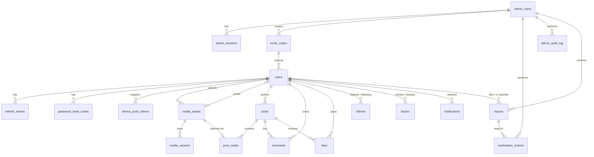

# Jamii Air — Backend Schema Document

| | |
|---|---|
| **Document** | 05 — Backend Schema |
| **Version** | 1.2 (Phase 1 implementation: aligned with what was built and tested; see §16) |
| **Status** | **Approved** — 2026-10-11 |
| **Date** | 2026-10-09 |
| **Scope** | PostgreSQL schema (Prisma), stored procedures, grants, object storage layout, Redis, retention |
| **Related** | [02 TRD §6 data-access strategy](02-technical-requirements-document.md) · [00 Review](00-README.md) |

---

## 1. Conventions

| Topic | Convention |
|---|---|
| Database | **PostgreSQL 18+**, database `jamii_air`, schema `public`. |
| Extensions | `citext` (case-insensitive username/email), `pg_trgm` (search). |
| Primary keys | **UUIDv7** generated **by the database** (`DEFAULT uuidv7()`, native in PostgreSQL 18). Required because rows are inserted by stored procedures, not by Prisma. Time-ordered → append-friendly indexes. |
| Naming | Tables, columns and enum types `snake_case` (Prisma `@@map`/`@map`); Prisma models `PascalCase`; API JSON `camelCase`. |
| Time | `TIMESTAMPTZ` (UTC). `created_at` on every table; `updated_at` maintained by trigger `fn__touch_updated_at` (Prisma's client-side `@updatedAt` is not used because Prisma doesn't write). |
| Writes | **Only via stored procedures** (§6). The runtime role has no INSERT/UPDATE/DELETE privileges (§9). |
| Deletes | User content soft-deleted (`deleted_at` / status) and purged after the retention window (§11). Join tables hard-deleted. |
| Integrity | Foreign keys, unique and `CHECK` constraints in the database. |
| Counters | Denormalised counters updated inside the same stored procedure as the source row; nightly reconciliation. |
| Binaries | Never in PostgreSQL — only object keys. |

## 2. Entity-relationship diagram



## 3. Table summary

| Table | Purpose | Written by |
|---|---|---|
| `users` | App accounts & profiles (18+) | auth, users, social, admin procedures |
| `invite_codes` | Pilot registration gate | `fn_admin_*_invite`, `fn_register_user` |
| `refresh_tokens` | Mobile sessions (rotating) | auth procedures |
| `password_reset_codes` | Reset OTPs | auth procedures |
| `device_push_tokens` | Expo push tokens per installation | notification procedures |
| `follows` · `blocks` | Social graph | social procedures |
| `media_assets` · `media_variants` | Uploads and sized derivatives | media procedures |
| `posts` · `post_media` | Posts (photo; reel in R2) and their ordered media | post procedures |
| `likes` · `comments` | Engagement | engagement procedures |
| `notifications` | Activity feed | engagement/social procedures |
| `reports` | User reports | `fn_submit_report`, admin procedures |
| `moderation_actions` | Audit of content/user moderation | admin procedures |
| `admin_users` · `admin_sessions` | Admin portal accounts & sessions (separate from users) | admin auth procedures |
| `admin_audit_log` | Audit of admin logins, admin management, invites | admin procedures |
| `idempotency_keys` | Retry-safe POSTs | `fn_create_post`, `fn_add_comment` |
| `pending_object_deletions` | Object-storage keys/prefixes the worker must delete | delete & purge procedures |
| `daily_metrics` | Pre-computed KPIs for the admin dashboard | `fn_maint_compute_daily_metrics` |

## 4. Prisma schema

> Prisma owns the table definitions and migrations. Things Prisma cannot express — `CHECK` constraints, partial and trigram indexes, triggers, stored procedures, grants — are added as raw SQL in the same migrations (§5–§9).

```prisma
// backend/prisma/schema.prisma

generator client {
  provider        = "prisma-client"            // ESM-native client (backend is "type": "module")
  output          = "../src/generated/prisma"
  previewFeatures = ["postgresqlExtensions", "typedSql"]
}

datasource db {
  provider   = "postgresql"
  extensions = [citext, pg_trgm]
  // URL from DATABASE_URL (runtime role jamii_app); migrations use the owner role (jamii_owner)
}

// ───────────── Enums ─────────────

enum UserStatus           { ACTIVE SUSPENDED PENDING_DELETION                       @@map("user_status") }
enum MediaKind            { IMAGE /* VIDEO in R2 */                                  @@map("media_kind") }
enum MediaPurpose         { POST AVATAR                                              @@map("media_purpose") }
enum MediaStatus          { PENDING_UPLOAD UPLOADED PROCESSING READY FAILED DELETED  @@map("media_status") }
enum MediaVariantType     { THUMB FEED AVATAR_S AVATAR_M /* POSTER, HLS_* in R2 */  @@map("media_variant_type") }
enum PostType             { PHOTO /* REEL in R2 */                                   @@map("post_type") }
enum PostStatus           { PROCESSING PUBLISHED FAILED HIDDEN DELETED               @@map("post_status") }
enum NotificationType     { FOLLOW LIKE COMMENT                                      @@map("notification_type") }
enum ReportTargetType     { USER POST COMMENT                                        @@map("report_target_type") }
enum ReportReason         { SPAM NUDITY HARASSMENT HATE VIOLENCE FALSE_INFORMATION OTHER @@map("report_reason") }
enum ReportStatus         { OPEN REVIEWING RESOLVED DISMISSED                        @@map("report_status") }
enum ModerationActionType {
  HIDE_POST UNHIDE_POST HIDE_COMMENT UNHIDE_COMMENT
  SUSPEND_USER REINSTATE_USER REVOKE_USER_SESSIONS
  RESOLVE_REPORT DISMISS_REPORT
  @@map("moderation_action_type")
}
enum AdminRole            { SUPER_ADMIN MODERATOR                                    @@map("admin_role") }
enum AdminStatus          { ACTIVE DISABLED                                          @@map("admin_status") }
enum Platform             { ANDROID IOS                                              @@map("platform") }

// (Prisma requires one enum value per line; shown compacted here for readability.)

// ───────────── App identity ─────────────

model User {
  id                  String     @id @default(dbgenerated("uuidv7()")) @db.Uuid
  username            String     @unique @db.Citext
  email               String     @unique @db.Citext
  passwordHash        String     @map("password_hash")
  dateOfBirth         DateTime   @map("date_of_birth") @db.Date        // 18+ enforced (§5)
  displayName         String?    @map("display_name") @db.VarChar(50)
  bio                 String?    @db.VarChar(160)
  avatarMediaId       String?    @unique @map("avatar_media_id") @db.Uuid
  status              UserStatus @default(ACTIVE)
  locale              String     @default("en") @db.VarChar(10)
  inviteCodeId        String?    @map("invite_code_id") @db.Uuid
  postCount           Int        @default(0) @map("post_count")
  followerCount       Int        @default(0) @map("follower_count")
  followingCount      Int        @default(0) @map("following_count")
  termsAcceptedAt     DateTime   @map("terms_accepted_at") @db.Timestamptz
  passwordChangedAt   DateTime?  @map("password_changed_at") @db.Timestamptz
  suspendedAt         DateTime?  @map("suspended_at") @db.Timestamptz
  deletionRequestedAt DateTime?  @map("deletion_requested_at") @db.Timestamptz
  lastActiveAt        DateTime?  @map("last_active_at") @db.Timestamptz
  createdAt           DateTime   @default(now()) @map("created_at") @db.Timestamptz
  updatedAt           DateTime   @default(now()) @map("updated_at") @db.Timestamptz

  avatar        MediaAsset?  @relation("UserAvatar", fields: [avatarMediaId], references: [id], onDelete: SetNull)
  inviteCode    InviteCode?  @relation(fields: [inviteCodeId], references: [id], onDelete: SetNull)
  mediaAssets   MediaAsset[] @relation("MediaOwner")
  posts         Post[]
  comments      Comment[]
  likes         Like[]
  following     Follow[]     @relation("Follower")
  followers     Follow[]     @relation("Following")
  blocking      Block[]      @relation("Blocker")
  blockedBy     Block[]      @relation("Blocked")
  notifications Notification[] @relation("NotificationRecipient")
  actedNotifs   Notification[] @relation("NotificationActor")
  refreshTokens RefreshToken[]
  resetCodes    PasswordResetCode[]
  devices       DevicePushToken[]
  reportsFiled  Report[]     @relation("Reporter")
  reportsAgainst Report[]    @relation("ReportedUser")
  modTargeted   ModerationAction[]

  @@index([status])
  @@map("users")
}

model InviteCode {
  id               String    @id @default(dbgenerated("uuidv7()")) @db.Uuid
  code             String    @unique @db.VarChar(32)
  createdByAdminId String?   @map("created_by_admin_id") @db.Uuid
  maxUses          Int       @default(1) @map("max_uses")
  useCount         Int       @default(0) @map("use_count")
  expiresAt        DateTime? @map("expires_at") @db.Timestamptz
  revokedAt        DateTime? @map("revoked_at") @db.Timestamptz
  createdAt        DateTime  @default(now()) @map("created_at") @db.Timestamptz

  createdBy AdminUser? @relation(fields: [createdByAdminId], references: [id], onDelete: SetNull)
  usedBy    User[]

  @@map("invite_codes")
}

model RefreshToken {
  id           String    @id @default(dbgenerated("uuidv7()")) @db.Uuid
  userId       String    @map("user_id") @db.Uuid
  familyId     String    @map("family_id") @db.Uuid
  tokenHash    String    @unique @map("token_hash") @db.Char(64)
  userAgent    String?   @map("user_agent") @db.VarChar(255)
  expiresAt    DateTime  @map("expires_at") @db.Timestamptz
  revokedAt    DateTime? @map("revoked_at") @db.Timestamptz
  replacedById String?   @map("replaced_by_id") @db.Uuid
  lastUsedAt   DateTime? @map("last_used_at") @db.Timestamptz
  createdAt    DateTime  @default(now()) @map("created_at") @db.Timestamptz

  user User @relation(fields: [userId], references: [id], onDelete: Cascade)

  @@index([userId])
  @@index([familyId])
  @@index([expiresAt])
  @@map("refresh_tokens")
}

model PasswordResetCode {
  id        String    @id @default(dbgenerated("uuidv7()")) @db.Uuid
  userId    String    @map("user_id") @db.Uuid
  codeHash  String    @map("code_hash") @db.Char(64)
  attempts  Int       @default(0)
  expiresAt DateTime  @map("expires_at") @db.Timestamptz
  usedAt    DateTime? @map("used_at") @db.Timestamptz
  createdAt DateTime  @default(now()) @map("created_at") @db.Timestamptz

  user User @relation(fields: [userId], references: [id], onDelete: Cascade)

  @@index([userId, createdAt(sort: Desc)])
  @@map("password_reset_codes")
}

model DevicePushToken {
  installationId String    @id @map("installation_id") @db.VarChar(64)
  userId         String    @map("user_id") @db.Uuid
  expoPushToken  String    @map("expo_push_token") @db.VarChar(255)
  platform       Platform
  appVersion     String?   @map("app_version") @db.VarChar(20)
  locale         String?   @db.VarChar(10)
  lastSeenAt     DateTime  @default(now()) @map("last_seen_at") @db.Timestamptz
  createdAt      DateTime  @default(now()) @map("created_at") @db.Timestamptz

  user User @relation(fields: [userId], references: [id], onDelete: Cascade)

  @@index([userId])
  @@map("device_push_tokens")
}

// ───────────── Social graph ─────────────

model Follow {
  followerId  String   @map("follower_id") @db.Uuid
  followingId String   @map("following_id") @db.Uuid
  createdAt   DateTime @default(now()) @map("created_at") @db.Timestamptz

  follower  User @relation("Follower",  fields: [followerId],  references: [id], onDelete: Cascade)
  following User @relation("Following", fields: [followingId], references: [id], onDelete: Cascade)

  @@id([followerId, followingId])
  @@index([followingId, createdAt(sort: Desc)])
  @@map("follows")
}

model Block {
  blockerId String   @map("blocker_id") @db.Uuid
  blockedId String   @map("blocked_id") @db.Uuid
  createdAt DateTime @default(now()) @map("created_at") @db.Timestamptz

  blocker User @relation("Blocker", fields: [blockerId], references: [id], onDelete: Cascade)
  blocked User @relation("Blocked", fields: [blockedId], references: [id], onDelete: Cascade)

  @@id([blockerId, blockedId])
  @@index([blockedId])
  @@map("blocks")
}

// ───────────── Media ─────────────

model MediaAsset {
  id            String       @id @default(dbgenerated("uuidv7()")) @db.Uuid
  ownerId       String       @map("owner_id") @db.Uuid
  kind          MediaKind
  purpose       MediaPurpose
  status        MediaStatus  @default(PENDING_UPLOAD)
  originalKey   String       @unique @map("original_key")
  mimeType      String       @map("mime_type") @db.VarChar(100)
  byteSize      BigInt       @map("byte_size")
  width         Int?
  height        Int?
  durationMs    Int?         @map("duration_ms")          // R2 video
  blurhash      String?      @db.VarChar(64)
  failureReason String?      @map("failure_reason") @db.VarChar(255)
  processedAt   DateTime?    @map("processed_at") @db.Timestamptz
  createdAt     DateTime     @default(now()) @map("created_at") @db.Timestamptz
  updatedAt     DateTime     @default(now()) @map("updated_at") @db.Timestamptz

  owner     User           @relation("MediaOwner", fields: [ownerId], references: [id], onDelete: Cascade)
  variants  MediaVariant[]
  postMedia PostMedia?
  avatarOf  User?          @relation("UserAvatar")

  @@index([ownerId, createdAt(sort: Desc)])
  @@index([status, updatedAt])
  @@map("media_assets")
}

model MediaVariant {
  id        String           @id @default(dbgenerated("uuidv7()")) @db.Uuid
  mediaId   String           @map("media_id") @db.Uuid
  variant   MediaVariantType
  objectKey String           @unique @map("object_key")
  width     Int
  height    Int
  mimeType  String           @map("mime_type") @db.VarChar(100)
  byteSize  Int              @map("byte_size")
  createdAt DateTime         @default(now()) @map("created_at") @db.Timestamptz

  media MediaAsset @relation(fields: [mediaId], references: [id], onDelete: Cascade)

  @@unique([mediaId, variant])
  @@map("media_variants")
}

// ───────────── Content ─────────────

model Post {
  id           String     @id @default(dbgenerated("uuidv7()")) @db.Uuid
  authorId     String     @map("author_id") @db.Uuid
  type         PostType   @default(PHOTO)
  caption      String?    @db.VarChar(2200)
  status       PostStatus @default(PROCESSING)
  likeCount    Int        @default(0) @map("like_count")
  commentCount Int        @default(0) @map("comment_count")
  publishedAt  DateTime?  @map("published_at") @db.Timestamptz
  hiddenAt     DateTime?  @map("hidden_at") @db.Timestamptz
  deletedAt    DateTime?  @map("deleted_at") @db.Timestamptz
  createdAt    DateTime   @default(now()) @map("created_at") @db.Timestamptz
  updatedAt    DateTime   @default(now()) @map("updated_at") @db.Timestamptz

  author        User           @relation(fields: [authorId], references: [id], onDelete: Cascade)
  media         PostMedia[]
  comments      Comment[]
  likes         Like[]
  notifications Notification[]
  reports       Report[]
  modActions    ModerationAction[]

  @@index([authorId, createdAt(sort: Desc), id(sort: Desc)])   // own grid incl. PROCESSING
  @@index([status, updatedAt])                                   // purge
  @@map("posts")
}

model PostMedia {
  postId   String @map("post_id") @db.Uuid
  mediaId  String @unique @map("media_id") @db.Uuid
  position Int    @default(0) @db.SmallInt

  post  Post       @relation(fields: [postId], references: [id], onDelete: Cascade)
  media MediaAsset @relation(fields: [mediaId], references: [id], onDelete: Cascade)

  @@id([postId, position])
  @@map("post_media")
}

model Like {
  userId    String   @map("user_id") @db.Uuid
  postId    String   @map("post_id") @db.Uuid
  createdAt DateTime @default(now()) @map("created_at") @db.Timestamptz

  user User @relation(fields: [userId], references: [id], onDelete: Cascade)
  post Post @relation(fields: [postId], references: [id], onDelete: Cascade)

  @@id([userId, postId])
  @@index([postId, createdAt(sort: Desc)])
  @@map("likes")
}

model Comment {
  id        String    @id @default(dbgenerated("uuidv7()")) @db.Uuid
  postId    String    @map("post_id") @db.Uuid
  authorId  String    @map("author_id") @db.Uuid
  body      String    @db.VarChar(1000)
  hiddenAt  DateTime? @map("hidden_at") @db.Timestamptz
  deletedAt DateTime? @map("deleted_at") @db.Timestamptz
  createdAt DateTime  @default(now()) @map("created_at") @db.Timestamptz

  post          Post               @relation(fields: [postId], references: [id], onDelete: Cascade)
  author        User               @relation(fields: [authorId], references: [id], onDelete: Cascade)
  notifications Notification[]
  reports       Report[]
  modActions    ModerationAction[]

  @@index([authorId])
  @@map("comments")
}

model Notification {
  id          String           @id @default(dbgenerated("uuidv7()")) @db.Uuid
  recipientId String           @map("recipient_id") @db.Uuid
  actorId     String           @map("actor_id") @db.Uuid
  type        NotificationType
  postId      String?          @map("post_id") @db.Uuid
  commentId   String?          @map("comment_id") @db.Uuid
  readAt      DateTime?        @map("read_at") @db.Timestamptz
  pushedAt    DateTime?        @map("pushed_at") @db.Timestamptz
  createdAt   DateTime         @default(now()) @map("created_at") @db.Timestamptz

  recipient User     @relation("NotificationRecipient", fields: [recipientId], references: [id], onDelete: Cascade)
  actor     User     @relation("NotificationActor",     fields: [actorId],     references: [id], onDelete: Cascade)
  post      Post?    @relation(fields: [postId],    references: [id], onDelete: Cascade)
  comment   Comment? @relation(fields: [commentId], references: [id], onDelete: Cascade)

  @@index([recipientId, createdAt(sort: Desc), id(sort: Desc)])
  @@map("notifications")
}

// ───────────── Safety & moderation ─────────────

model Report {
  id              String           @id @default(dbgenerated("uuidv7()")) @db.Uuid
  reporterId      String           @map("reporter_id") @db.Uuid
  targetType      ReportTargetType @map("target_type")
  targetPostId    String?          @map("target_post_id") @db.Uuid
  targetCommentId String?          @map("target_comment_id") @db.Uuid
  reportedUserId  String           @map("reported_user_id") @db.Uuid
  reason          ReportReason
  details         String?          @db.VarChar(1000)
  status          ReportStatus     @default(OPEN)
  resolvedById    String?          @map("resolved_by_id") @db.Uuid     // admin_users.id
  resolvedAt      DateTime?        @map("resolved_at") @db.Timestamptz
  createdAt       DateTime         @default(now()) @map("created_at") @db.Timestamptz
  updatedAt       DateTime         @default(now()) @map("updated_at") @db.Timestamptz

  reporter      User       @relation("Reporter",     fields: [reporterId],     references: [id], onDelete: Cascade)
  reportedUser  User       @relation("ReportedUser", fields: [reportedUserId], references: [id], onDelete: Cascade)
  resolvedBy    AdminUser? @relation(fields: [resolvedById], references: [id], onDelete: SetNull)
  targetPost    Post?      @relation(fields: [targetPostId],    references: [id], onDelete: SetNull)
  targetComment Comment?   @relation(fields: [targetCommentId], references: [id], onDelete: SetNull)
  actions       ModerationAction[]

  @@index([status, createdAt])
  @@index([reportedUserId, createdAt(sort: Desc)])
  @@map("reports")
}

model ModerationAction {
  id              String               @id @default(dbgenerated("uuidv7()")) @db.Uuid
  adminId         String               @map("admin_id") @db.Uuid
  action          ModerationActionType
  reportId        String?              @map("report_id") @db.Uuid
  targetUserId    String?              @map("target_user_id") @db.Uuid
  targetPostId    String?              @map("target_post_id") @db.Uuid
  targetCommentId String?              @map("target_comment_id") @db.Uuid
  note            String               @db.VarChar(500)
  createdAt       DateTime             @default(now()) @map("created_at") @db.Timestamptz

  admin         AdminUser @relation(fields: [adminId], references: [id], onDelete: Restrict)
  report        Report?   @relation(fields: [reportId],        references: [id], onDelete: SetNull)
  targetUser    User?     @relation(fields: [targetUserId],    references: [id], onDelete: SetNull)
  targetPost    Post?     @relation(fields: [targetPostId],    references: [id], onDelete: SetNull)
  targetComment Comment?  @relation(fields: [targetCommentId], references: [id], onDelete: SetNull)

  @@index([createdAt(sort: Desc)])
  @@index([targetUserId])
  @@map("moderation_actions")
}

// ───────────── Admin portal ─────────────

model AdminUser {
  id               String      @id @default(dbgenerated("uuidv7()")) @db.Uuid
  email            String      @unique @db.Citext
  displayName      String      @map("display_name") @db.VarChar(80)
  passwordHash     String      @map("password_hash")
  role             AdminRole   @default(MODERATOR)
  status           AdminStatus @default(ACTIVE)
  totpSecretEnc    Bytes?      @map("totp_secret_enc")          // AES-256-GCM ciphertext; key outside DB
  totpEnabledAt    DateTime?   @map("totp_enabled_at") @db.Timestamptz
  failedLoginCount Int         @default(0) @map("failed_login_count")
  lockedAt         DateTime?   @map("locked_at") @db.Timestamptz
  lastLoginAt      DateTime?   @map("last_login_at") @db.Timestamptz
  createdById      String?     @map("created_by_id") @db.Uuid
  createdAt        DateTime    @default(now()) @map("created_at") @db.Timestamptz
  updatedAt        DateTime    @default(now()) @map("updated_at") @db.Timestamptz

  createdBy   AdminUser?  @relation("AdminCreatedBy", fields: [createdById], references: [id], onDelete: SetNull)
  created     AdminUser[] @relation("AdminCreatedBy")
  sessions    AdminSession[]
  invites     InviteCode[]
  modActions  ModerationAction[]
  auditLog    AdminAuditLog[]
  resolved    Report[]

  @@map("admin_users")
}

model AdminSession {
  id             String    @id @default(dbgenerated("uuidv7()")) @db.Uuid
  adminId        String    @map("admin_id") @db.Uuid
  familyId       String    @map("family_id") @db.Uuid
  tokenHash      String    @unique @map("token_hash") @db.Char(64)
  userAgent      String?   @map("user_agent") @db.VarChar(255)
  idleExpiresAt  DateTime  @map("idle_expires_at") @db.Timestamptz      // now() + 30 min, extended on use
  absoluteExpiresAt DateTime @map("absolute_expires_at") @db.Timestamptz // login + 12 h
  revokedAt      DateTime? @map("revoked_at") @db.Timestamptz
  replacedById   String?   @map("replaced_by_id") @db.Uuid
  createdAt      DateTime  @default(now()) @map("created_at") @db.Timestamptz

  admin AdminUser @relation(fields: [adminId], references: [id], onDelete: Cascade)

  @@index([adminId])
  @@index([familyId])
  @@map("admin_sessions")
}

model AdminAuditLog {
  id         String   @id @default(dbgenerated("uuidv7()")) @db.Uuid
  adminId    String?  @map("admin_id") @db.Uuid               // null for failed login of unknown email
  action     String   @db.VarChar(50)                        // LOGIN_SUCCESS, LOGIN_FAILED, TOTP_ENABLED, ADMIN_CREATED, …
  targetType String?  @map("target_type") @db.VarChar(30)
  targetId   String?  @map("target_id") @db.Uuid
  details    Json?
  createdAt  DateTime @default(now()) @map("created_at") @db.Timestamptz

  admin AdminUser? @relation(fields: [adminId], references: [id], onDelete: SetNull)

  @@index([createdAt(sort: Desc)])
  @@index([adminId, createdAt(sort: Desc)])
  @@map("admin_audit_log")
}

// ───────────── Platform ─────────────

model IdempotencyKey {
  userId         String   @map("user_id") @db.Uuid
  key            String   @db.VarChar(64)
  route          String   @db.VarChar(100)
  requestHash    String   @map("request_hash") @db.Char(64)
  responseBody   Json     @map("response_body")
  createdAt      DateTime @default(now()) @map("created_at") @db.Timestamptz

  @@id([userId, key])
  @@index([createdAt])
  @@map("idempotency_keys")
}

model PendingObjectDeletion {
  id        String    @id @default(dbgenerated("uuidv7()")) @db.Uuid
  objectKey String    @map("object_key")                     // exact key, or prefix ending in '/'
  isPrefix  Boolean   @default(false) @map("is_prefix")
  claimedAt DateTime? @map("claimed_at") @db.Timestamptz
  doneAt    DateTime? @map("done_at") @db.Timestamptz
  createdAt DateTime  @default(now()) @map("created_at") @db.Timestamptz

  @@index([doneAt, createdAt])
  @@map("pending_object_deletions")
}

model DailyMetric {
  day    DateTime @db.Date
  metric String   @db.VarChar(50)
  value  Decimal  @db.Decimal(14, 4)

  @@id([day, metric])
  @@map("daily_metrics")
}
```

## 5. Constraints, indexes & triggers (raw SQL in migrations)

```sql
-- 5.1 CHECK constraints
-- Letter case is kept for display; uniqueness ignores it (citext).
ALTER TABLE users ADD CONSTRAINT users_username_format CHECK (username::text ~ '^[A-Za-z0-9._]{3,30}$');
ALTER TABLE users ADD CONSTRAINT users_min_age_18
  CHECK (date_of_birth <= ((created_at AT TIME ZONE 'UTC')::date - INTERVAL '18 years'));
ALTER TABLE users ADD CONSTRAINT users_counts_nonneg
  CHECK (post_count >= 0 AND follower_count >= 0 AND following_count >= 0);
ALTER TABLE follows ADD CONSTRAINT follows_no_self CHECK (follower_id <> following_id);
ALTER TABLE blocks  ADD CONSTRAINT blocks_no_self  CHECK (blocker_id  <> blocked_id);
ALTER TABLE posts   ADD CONSTRAINT posts_counts_nonneg CHECK (like_count >= 0 AND comment_count >= 0);
ALTER TABLE post_media ADD CONSTRAINT post_media_position CHECK (position BETWEEN 0 AND 9);
ALTER TABLE invite_codes ADD CONSTRAINT invite_uses CHECK (use_count >= 0 AND use_count <= max_uses);
ALTER TABLE notifications ADD CONSTRAINT notifications_no_self CHECK (recipient_id <> actor_id);
ALTER TABLE notifications ADD CONSTRAINT notifications_target CHECK (
  (type = 'FOLLOW'  AND post_id IS NULL) OR
  (type = 'LIKE'    AND post_id IS NOT NULL) OR
  (type = 'COMMENT' AND post_id IS NOT NULL AND comment_id IS NOT NULL));
ALTER TABLE reports ADD CONSTRAINT reports_target CHECK (
  (target_type = 'USER'    AND target_post_id IS NULL AND target_comment_id IS NULL) OR
  (target_type = 'POST'    AND target_comment_id IS NULL) OR
  (target_type = 'COMMENT' AND target_post_id IS NULL));
ALTER TABLE moderation_actions ADD CONSTRAINT moderation_note_len CHECK (length(btrim(note)) >= 3);
-- Also in the migrations (Phase 1): users.locale IN ('en','sw'); password hashes must be Argon2id
-- ('$argon2id$%', users and admin_users); token, reset-code and request hashes must be 64 hex
-- characters (SR-05: plaintext can never be stored); status / timestamp consistency on users,
-- posts and reports; media type and size limits (MD-01) and the object-key layout (§10) on
-- media_assets; invite max_uses 1–1000 and code format; admin_sessions idle ≤ absolute expiry.

-- 5.2 Partial indexes (hot paths)
CREATE INDEX posts_published_author_created_idx
  ON posts (author_id, created_at DESC, id DESC) WHERE status = 'PUBLISHED';
CREATE INDEX comments_visible_post_created_idx
  ON comments (post_id, created_at, id) WHERE deleted_at IS NULL AND hidden_at IS NULL;
CREATE INDEX notifications_unread_idx ON notifications (recipient_id) WHERE read_at IS NULL;
CREATE INDEX reports_open_idx ON reports (created_at, id) WHERE status IN ('OPEN', 'REVIEWING');
-- One open report per reporter and target (fn_submit_report returns the existing one).
CREATE UNIQUE INDEX reports_open_dedupe ON reports
  (reporter_id, target_type, COALESCE(target_post_id, target_comment_id, reported_user_id))
  WHERE status IN ('OPEN', 'REVIEWING');

-- 5.3 Notification de-duplication (used with ON CONFLICT DO NOTHING)
CREATE UNIQUE INDEX notifications_like_dedupe   ON notifications (recipient_id, actor_id, post_id) WHERE type = 'LIKE';
CREATE UNIQUE INDEX notifications_follow_dedupe ON notifications (recipient_id, actor_id)          WHERE type = 'FOLLOW';

-- 5.4 Search (gin_trgm_ops is defined for text, so index text expressions)
CREATE INDEX users_username_trgm_idx     ON users USING gin ((lower(username::text)) gin_trgm_ops);
CREATE INDEX users_display_name_trgm_idx ON users USING gin ((lower(display_name)) gin_trgm_ops);
-- Prefix matches (ranked first) read a btree.
CREATE INDEX users_username_prefix_idx     ON users ((lower(username::text)) text_pattern_ops);
CREATE INDEX users_display_name_prefix_idx ON users ((lower(display_name)) text_pattern_ops);

-- 5.5 updated_at trigger
CREATE OR REPLACE FUNCTION fn__touch_updated_at() RETURNS trigger
LANGUAGE plpgsql AS $$ BEGIN NEW.updated_at := now(); RETURN NEW; END $$;

DO $$ DECLARE t text; BEGIN
  FOREACH t IN ARRAY ARRAY['users','media_assets','posts','reports','admin_users'] LOOP
    EXECUTE format('CREATE TRIGGER %I BEFORE UPDATE ON %I FOR EACH ROW EXECUTE FUNCTION fn__touch_updated_at()',
                   t || '_touch_updated_at', t);
  END LOOP;
END $$;
```

## 6. Stored-procedure conventions (summary)

Full rules are in [TRD §6](02-technical-requirements-document.md). In short:

1. **Functions** (`CREATE FUNCTION`) for every activity; `fn_<verb>_<noun>`, admin `fn_admin_*`, maintenance `fn_maint_*`, internal helpers `fn__*` (not executable by the app).
   *Why not `CREATE PROCEDURE` for maintenance?* PostgreSQL forbids `COMMIT` inside a procedure that is `SECURITY DEFINER` or has a `SET` clause. Instead, maintenance functions process **one batch per call** and the worker calls them in a loop until they return 0 — same effect, same security model.
2. First parameter is the actor (`p_viewer_id` / `p_admin_id`); data-dependent authorization is checked inside.
3. `SECURITY DEFINER`, `SET search_path = public, pg_temp`, owner `jamii_owner`.
4. `#variable_conflict use_column` at the top of every PL/pgSQL function that `RETURNS TABLE` (output column names would otherwise clash with table columns).
5. Business errors: `RAISE EXCEPTION USING ERRCODE = 'JA<http>', MESSAGE = '<API_CODE>'`.
6. **If a function must both persist something and report failure, it returns an `outcome` column instead of raising** — raising rolls back the whole transaction (e.g. refresh-token reuse must keep the family revocation).
7. Keyset pagination: a missing cursor becomes the sentinel `('infinity', 'ffffffff-ffff-ffff-ffff-ffffffffffff')` so one index-friendly predicate `(created_at, id) < (cursor)` serves every page.
8. External side effects (push, email, S3, image processing) happen in Node **after** the function returns; functions return the IDs needed.

### 6.1 Error codes raised by procedures

| SQLSTATE | Message (API `error.code`) |
|---|---|
| `JA400` | `INVITE_INVALID`, `INVALID_CURSOR`, `MEDIA_NOT_ATTACHABLE`, `CAPTION_TOO_LONG`, `INVALID_VARIANT_KEY` (worker) |
| `JA401` | `ACCOUNT_NOT_ACTIVE` |
| `JA403` | `ACCOUNT_SUSPENDED`, `NOT_OWNER`, `BLOCKED`, `ADMIN_FORBIDDEN` |
| `JA404` | `USER_NOT_FOUND`, `POST_NOT_FOUND`, `COMMENT_NOT_FOUND`, `MEDIA_NOT_FOUND`, `REPORT_NOT_FOUND`, `INVITE_NOT_FOUND`, `ADMIN_NOT_FOUND` |
| `JA409` | `USERNAME_TAKEN`, `EMAIL_TAKEN` (users and admins), `IDEMPOTENCY_KEY_REUSED`, `REPORT_ALREADY_HANDLED`, `INVALID_STATE` |
| `JA422` | `UNDER_MINIMUM_AGE`, `NOTE_REQUIRED`, `CANNOT_FOLLOW_SELF`, `CANNOT_BLOCK_SELF`, `CANNOT_REPORT_SELF` |

## 7. Stored-procedure catalogue (R1)

`viewer` = `p_viewer_id uuid`; `cursor` = `p_cursor_time timestamptz, p_cursor_id uuid, p_limit int`. **R** = read (`STABLE`), **W** = write (`VOLATILE`).

### 7.1 Internal helpers (not granted to `jamii_app`)

| Function | Purpose |
|---|---|
| `fn__assert_active_user(user_id)` | Raises `JA401 ACCOUNT_NOT_ACTIVE` / `JA403 ACCOUNT_SUSPENDED`. |
| `fn__is_blocked_either_way(a, b) → boolean` | Block check in both directions. |
| `fn__assert_admin(admin_id, roles admin_role[])` | Admin exists, ACTIVE, has one of the roles; else `JA403 ADMIN_FORBIDDEN`. |
| `fn__cursor(time, id, limit) → (cursor_time, cursor_id, page_limit)` | Applies the sentinel for a missing cursor; clamps the page size to 1–50 (default 20) and adds 1. |
| `fn__resolve_profile(viewer, username) → (target_id, blocked_by_me)` | Profile lookup for reads: `JA404` if unknown, not ACTIVE, or the target blocked the viewer. |
| `fn__assert_post_visible(viewer, post_id) → author_id` | PUBLISHED, author ACTIVE, no block either way; else `JA404 POST_NOT_FOUND`. |
| `fn__queue_media_deletion(media_ids)` | Media → DELETED and their object prefixes into `pending_object_deletions`. |
| `fn__admin_audit(…)` · `fn__require_note(note)` · `fn__close_report(report_id, admin_id)` | Admin audit row; `JA422 NOTE_REQUIRED`; resolve the report an action was taken from. |
| `fn__touch_updated_at()` | Trigger (§5.5). |

### 7.2 Auth & account

| Function | R/W | Returns | Notes |
|---|---|---|---|
| `fn_register_user(email, username, password_hash, date_of_birth, invite_code, locale, require_invite, refresh_hash, refresh_expires_at, user_agent)` | W | `user_id, family_id` | Age ≥ 18, invite consumption, unique checks, first session — all in one transaction. |
| `fn_get_login_candidate(identifier)` | R | `user_id, password_hash, status, deletion_requested_at` | Node verifies Argon2id. Returns no row for unknown identifier. |
| `fn_create_session(user_id, refresh_hash, expires_at, user_agent, cancel_deletion)` | W | `family_id` | Optionally cancels a pending deletion; updates `last_active_at`. |
| `fn_rotate_refresh_token(old_hash, new_hash, new_expires_at)` | W | `outcome, user_id, family_id` | `outcome ∈ OK, INVALID, EXPIRED, REUSE_DETECTED, NOT_ACTIVE` (§8.2). |
| `fn_revoke_session(refresh_hash, installation_id)` | W | `revoked` | Also removes the device push token. |
| `fn_create_password_reset(email, code_hash, expires_at)` | W | `user_id, email, locale` (0 rows if unknown) | Node sends email only if a row is returned; API always answers the same. |
| `fn_reset_password(email, code_hash, new_password_hash)` | W | `outcome` | Max 5 attempts; revokes all sessions on success. |
| `fn_update_profile(viewer, patch jsonb)` | W | profile row | Only keys present in `patch` change. The avatar must be the viewer's own media with purpose AVATAR that has not failed; a just-uploaded one is marked UPLOADED and the API enqueues its processing (a no-op if already READY). The replaced avatar is queued for deletion. |
| `fn_request_account_deletion(viewer)` | W | `deletion_due_at` | Password checked in Node first; revokes sessions and device tokens. |

### 7.3 Users & social graph

| Function | R/W | Returns |
|---|---|---|
| `fn_get_profile(viewer, username)` | R | profile + `is_following`, `is_blocked_by_me`, avatar keys (404 if blocked either way or not ACTIVE) |
| `fn_search_users(viewer, q, limit)` | R | id, username, display_name, avatar key |
| `fn_get_followers(viewer, username, cursor)` · `fn_get_following(…)` | R | user rows + `is_following` |
| `fn_follow_user(viewer, target_id)` | W | `following, follower_count, notification_id` |
| `fn_unfollow_user(viewer, target_id)` | W | `following, follower_count` |
| `fn_block_user(viewer, target_id)` | W | `blocked` — removes follows both ways + counters |
| `fn_unblock_user(viewer, target_id)` | W | `blocked` |
| `fn_get_blocked_users(viewer, cursor)` | R | user rows |

### 7.4 Media & posts

| Function | R/W | Returns |
|---|---|---|
| `fn_create_upload_intent(viewer, kind, purpose, mime_type, byte_size)` | W | `media_id, original_key` (key built in SQL: `users/{viewer}/media/{id}/original`) |
| `fn_create_post(viewer, media_ids uuid[], caption, idempotency_key, request_hash)` | W | post row + `media_to_process uuid[]`, `replayed boolean` |
| `fn_complete_media_processing(media_id, width, height, blurhash, variants jsonb)` | W | `post_id, post_published boolean, author_id` |
| `fn_fail_media_processing(media_id, reason)` | W | `post_id, author_id` |
| `fn_get_post(viewer, post_id)` | R | feed-item shape |
| `fn_update_post_caption(viewer, post_id, caption)` | W | post row |
| `fn_delete_post(viewer, post_id)` | W | `deleted` — queues object deletion rows |
| `fn_get_home_feed(viewer, cursor)` | R | feed items (§8.1) |
| `fn_get_profile_posts(viewer, username, cursor)` | R | id, status, thumb key, created_at |

### 7.5 Engagement & notifications

| Function | R/W | Returns |
|---|---|---|
| `fn_like_post(viewer, post_id)` · `fn_unlike_post(…)` | W | `liked, like_count, notification_id` |
| `fn_add_comment(viewer, post_id, body, idempotency_key, request_hash)` | W | comment row + `notification_id`, `replayed` |
| `fn_delete_comment(viewer, comment_id)` | W | `deleted` (author or post owner) |
| `fn_get_post_comments(viewer, post_id, cursor)` | R | comment rows with author |
| `fn_get_notifications(viewer, cursor)` | R | rows with actor + post thumb |
| `fn_get_unread_count(viewer)` | R | `count` (capped at 100) |
| `fn_mark_notifications_read(viewer, ids uuid[], mark_all boolean)` | W | `updated` |
| `fn_get_push_payload(notification_id)` | R | recipient tokens, locale, actor username, type, post_id (worker) |
| `fn_mark_notification_pushed(notification_id)` · `fn_delete_device_tokens(tokens text[])` | W | worker bookkeeping |
| `fn_upsert_device_token(viewer, installation_id, token, platform, app_version, locale)` · `fn_remove_device_token(viewer, installation_id)` | W | — |
| `fn_submit_report(viewer, target_type, target_id, reason, details)` | W | `report_id` (duplicate open report by same reporter → returns existing id) |

### 7.6 Admin portal

| Function | R/W | Roles |
|---|---|---|
| `fn_admin_get_login_candidate(email)` · `fn_admin_record_login(admin_id, success, user_agent)` | R / W | — (locks after 10 failures; audit-logged) |
| `fn_admin_enable_totp(admin_id, secret_enc)` | W | self |
| `fn_admin_create_session(admin_id, hash, idle_exp, abs_exp, ua)` · `fn_admin_rotate_session(old, new, idle_exp)` · `fn_admin_revoke_session(hash)` | W | — |
| `fn_admin_dashboard(admin_id, from, to)` | R | any |
| `fn_admin_list_reports(admin_id, status[], type, cursor)` · `fn_admin_get_report(admin_id, report_id)` | R / W* | any (*opening moves OPEN → REVIEWING) |
| `fn_admin_update_report(admin_id, report_id, status, note)` | W | any |
| `fn_admin_search_users(admin_id, q, status, cursor)` · `fn_admin_get_user(admin_id, user_id)` | R | any |
| `fn_admin_suspend_user(admin_id, user_id, note, report_id)` · `fn_admin_reinstate_user(…)` · `fn_admin_revoke_user_sessions(…)` | W | any |
| `fn_admin_get_post(admin_id, post_id)` · `fn_admin_set_post_hidden(admin_id, post_id, hidden, note, report_id)` · `fn_admin_set_comment_hidden(…)` | R / W | any |
| `fn_admin_list_invites` · `fn_admin_create_invite(admin_id, max_uses, expires_at)` · `fn_admin_revoke_invite` | R / W | any |
| `fn_admin_list_audit(admin_id, filters, cursor)` | R | any |
| `fn_admin_list_admins` · `fn_admin_create_admin` · `fn_admin_update_admin(role, status)` · `fn_admin_reset_admin_totp` | R / W | SUPER_ADMIN |
| `fn_admin_bootstrap_super_admin(email, display_name, hash)` | W | — (only while `admin_users` is empty; a deployment step) |
| `fn_admin_change_password(admin_id, hash)` | W | self (ends the admin's sessions) |

### 7.7 Maintenance (worker, called in a loop until `0`)

| Function | Schedule | Does |
|---|---|---|
| `fn_maint_cleanup_upload_intents(batch)` | hourly | PENDING_UPLOAD > 24 h → DELETED + object deletion rows |
| `fn_maint_requeue_stuck_media(batch)` | every 10 min | returns media UPLOADED/PROCESSING > 10 min for re-enqueue; fails media stuck > 24 h |
| `fn_maint_claim_object_deletions(batch)` · `fn_maint_complete_object_deletions(ids)` | every 5 min | worker deletes from S3 between the two calls |
| `fn_maint_purge_deleted_content(batch)` | daily 03:00 | hard-delete posts/comments soft-deleted > 30 days |
| `fn_maint_purge_deleted_accounts(batch)` | daily 03:30 | users PENDING_DELETION > 30 days: fix counters, queue prefix deletion, delete |
| `fn_maint_purge_expired_tokens(batch)` | daily | refresh/admin sessions/reset codes past retention |
| `fn_maint_purge_idempotency_keys(batch)` · `fn_maint_purge_old_notifications(batch)` | hourly / daily | retention |
| `fn_maint_reconcile_counters(since)` | daily 02:00 | recompute counters for recently changed rows; returns drift count (metric) |
| `fn_maint_compute_daily_metrics(day)` | daily 00:30 | upsert KPIs into `daily_metrics` |

## 8. Reference implementations

These four functions set the pattern every other procedure follows.

### 8.1 `fn_get_home_feed` — complex read, single round trip

```sql
CREATE OR REPLACE FUNCTION fn_get_home_feed(
  p_viewer_id   uuid,
  p_cursor_time timestamptz DEFAULT NULL,
  p_cursor_id   uuid        DEFAULT NULL,
  p_limit       int         DEFAULT 20)
RETURNS TABLE (
  post_id uuid, created_at timestamptz, caption varchar, like_count int, comment_count int,
  liked_by_me boolean, author_id uuid, author_username citext, author_display_name varchar,
  author_avatar_key text, media jsonb)
LANGUAGE plpgsql STABLE SECURITY DEFINER
SET search_path = public, pg_temp
AS $$
#variable_conflict use_column
DECLARE
  v_time  timestamptz := COALESCE(p_cursor_time, 'infinity');
  v_id    uuid        := COALESCE(p_cursor_id, 'ffffffff-ffff-ffff-ffff-ffffffffffff');
  v_limit int         := LEAST(GREATEST(COALESCE(p_limit, 20), 1), 50) + 1;   -- +1 ⇒ has next page
BEGIN
  PERFORM fn__assert_active_user(p_viewer_id);

  RETURN QUERY
  WITH authors AS (
    SELECT f.following_id AS id FROM follows f WHERE f.follower_id = p_viewer_id
    UNION ALL
    SELECT p_viewer_id
  ),
  page AS (
    SELECT p.id, p.author_id, p.caption, p.like_count, p.comment_count, p.created_at
    FROM posts p
    JOIN users u ON u.id = p.author_id AND u.status = 'ACTIVE'
    WHERE p.author_id IN (SELECT id FROM authors)
      AND p.status = 'PUBLISHED'
      AND (p.created_at, p.id) < (v_time, v_id)
      AND NOT EXISTS (SELECT 1 FROM blocks b
                      WHERE (b.blocker_id = p_viewer_id AND b.blocked_id = p.author_id)
                         OR (b.blocker_id = p.author_id AND b.blocked_id = p_viewer_id))
    ORDER BY p.created_at DESC, p.id DESC
    LIMIT v_limit
  )
  SELECT pg.id, pg.created_at, pg.caption, pg.like_count, pg.comment_count,
         EXISTS (SELECT 1 FROM likes l WHERE l.user_id = p_viewer_id AND l.post_id = pg.id),
         u.id, u.username, u.display_name, av.object_key,
         m.media
  FROM page pg
  JOIN users u ON u.id = pg.author_id
  LEFT JOIN media_variants av ON av.media_id = u.avatar_media_id AND av.variant = 'AVATAR_S'
  CROSS JOIN LATERAL (
    SELECT jsonb_agg(jsonb_build_object(
             'id', ma.id, 'kind', ma.kind, 'blurhash', ma.blurhash,
             'feedKey', fv.object_key, 'thumbKey', tv.object_key,
             'width', fv.width, 'height', fv.height) ORDER BY pm.position) AS media
    FROM post_media pm
    JOIN media_assets ma ON ma.id = pm.media_id
    LEFT JOIN media_variants fv ON fv.media_id = ma.id AND fv.variant = 'FEED'
    LEFT JOIN media_variants tv ON tv.media_id = ma.id AND tv.variant = 'THUMB'
    WHERE pm.post_id = pg.id
  ) m
  ORDER BY pg.created_at DESC, pg.id DESC;
END $$;
```

NestJS converts object keys to CDN URLs and builds `nextCursor` from the 21st row (if present).

### 8.2 `fn_rotate_refresh_token` — persist *and* report failure

```sql
CREATE OR REPLACE FUNCTION fn_rotate_refresh_token(
  p_old_hash char(64), p_new_hash char(64), p_new_expires_at timestamptz)
RETURNS TABLE (outcome text, user_id uuid, family_id uuid)
LANGUAGE plpgsql VOLATILE SECURITY DEFINER
SET search_path = public, pg_temp
AS $$
#variable_conflict use_column
DECLARE
  r        refresh_tokens%ROWTYPE;
  v_status user_status;
  v_new_id uuid;
BEGIN
  SELECT * INTO r FROM refresh_tokens WHERE token_hash = p_old_hash FOR UPDATE;
  IF NOT FOUND THEN
    RETURN QUERY SELECT 'INVALID', NULL::uuid, NULL::uuid; RETURN;
  END IF;

  IF r.revoked_at IS NOT NULL THEN
    -- Reuse of a rotated token ⇒ assume theft: revoke the whole family.
    -- We RETURN (not RAISE) so this revocation is committed.
    UPDATE refresh_tokens SET revoked_at = now()
    WHERE family_id = r.family_id AND revoked_at IS NULL;
    RETURN QUERY SELECT 'REUSE_DETECTED', r.user_id, r.family_id; RETURN;
  END IF;

  IF r.expires_at <= now() THEN
    RETURN QUERY SELECT 'EXPIRED', r.user_id, r.family_id; RETURN;
  END IF;

  SELECT u.status INTO v_status FROM users u WHERE u.id = r.user_id;
  IF v_status <> 'ACTIVE' THEN
    UPDATE refresh_tokens SET revoked_at = now() WHERE family_id = r.family_id AND revoked_at IS NULL;
    RETURN QUERY SELECT 'NOT_ACTIVE', r.user_id, r.family_id; RETURN;
  END IF;

  INSERT INTO refresh_tokens (user_id, family_id, token_hash, user_agent, expires_at)
  VALUES (r.user_id, r.family_id, p_new_hash, r.user_agent, p_new_expires_at)
  RETURNING id INTO v_new_id;

  UPDATE refresh_tokens SET revoked_at = now(), replaced_by_id = v_new_id, last_used_at = now()
  WHERE id = r.id;
  UPDATE users SET last_active_at = now() WHERE id = r.user_id;

  RETURN QUERY SELECT 'OK', r.user_id, r.family_id;
END $$;
```

### 8.3 `fn_like_post` — write with counter + notification

```sql
CREATE OR REPLACE FUNCTION fn_like_post(p_viewer_id uuid, p_post_id uuid)
RETURNS TABLE (liked boolean, like_count int, notification_id uuid)
LANGUAGE plpgsql VOLATILE SECURITY DEFINER
SET search_path = public, pg_temp
AS $$
#variable_conflict use_column
DECLARE
  v_author_id uuid;
  v_rows      int;
  v_count     int;
  v_notif_id  uuid;
BEGIN
  PERFORM fn__assert_active_user(p_viewer_id);

  SELECT p.author_id INTO v_author_id
  FROM posts p JOIN users u ON u.id = p.author_id
  WHERE p.id = p_post_id AND p.status = 'PUBLISHED' AND u.status = 'ACTIVE';

  IF NOT FOUND OR fn__is_blocked_either_way(p_viewer_id, v_author_id) THEN
    RAISE EXCEPTION USING ERRCODE = 'JA404', MESSAGE = 'POST_NOT_FOUND';
  END IF;

  INSERT INTO likes (user_id, post_id) VALUES (p_viewer_id, p_post_id) ON CONFLICT DO NOTHING;
  GET DIAGNOSTICS v_rows = ROW_COUNT;

  IF v_rows = 1 THEN
    UPDATE posts SET like_count = like_count + 1 WHERE id = p_post_id
    RETURNING posts.like_count INTO v_count;

    IF v_author_id <> p_viewer_id THEN
      INSERT INTO notifications (recipient_id, actor_id, type, post_id)
      VALUES (v_author_id, p_viewer_id, 'LIKE', p_post_id)
      ON CONFLICT DO NOTHING                      -- dedupe index: like→unlike→like notifies once
      RETURNING id INTO v_notif_id;
    END IF;
  ELSE
    SELECT p.like_count INTO v_count FROM posts p WHERE p.id = p_post_id;   -- already liked: idempotent
  END IF;

  RETURN QUERY SELECT true, v_count, v_notif_id;
END $$;
```

### 8.4 `fn_admin_suspend_user` — admin write with audit

```sql
CREATE OR REPLACE FUNCTION fn_admin_suspend_user(
  p_admin_id uuid, p_user_id uuid, p_note varchar, p_report_id uuid DEFAULT NULL)
RETURNS TABLE (user_id uuid, status user_status)
LANGUAGE plpgsql VOLATILE SECURITY DEFINER
SET search_path = public, pg_temp
AS $$
#variable_conflict use_column
BEGIN
  PERFORM fn__assert_admin(p_admin_id, ARRAY['SUPER_ADMIN', 'MODERATOR']::admin_role[]);

  IF p_note IS NULL OR length(btrim(p_note)) < 3 THEN
    RAISE EXCEPTION USING ERRCODE = 'JA422', MESSAGE = 'NOTE_REQUIRED';
  END IF;

  UPDATE users SET status = 'SUSPENDED', suspended_at = now()
  WHERE id = p_user_id AND status = 'ACTIVE';
  IF NOT FOUND THEN
    IF EXISTS (SELECT 1 FROM users WHERE id = p_user_id) THEN
      RAISE EXCEPTION USING ERRCODE = 'JA409', MESSAGE = 'INVALID_STATE';
    END IF;
    RAISE EXCEPTION USING ERRCODE = 'JA404', MESSAGE = 'USER_NOT_FOUND';
  END IF;

  UPDATE refresh_tokens SET revoked_at = now() WHERE user_id = p_user_id AND revoked_at IS NULL;
  DELETE FROM device_push_tokens WHERE user_id = p_user_id;

  INSERT INTO moderation_actions (admin_id, action, report_id, target_user_id, note)
  VALUES (p_admin_id, 'SUSPEND_USER', p_report_id, p_user_id, p_note);

  IF p_report_id IS NOT NULL THEN
    UPDATE reports SET status = 'RESOLVED', resolved_by_id = p_admin_id, resolved_at = now()
    WHERE id = p_report_id AND status IN ('OPEN', 'REVIEWING');
  END IF;

  -- Content is hidden implicitly: every user-facing read filters on users.status = 'ACTIVE'.
  RETURN QUERY SELECT p_user_id, 'SUSPENDED'::user_status;
END $$;
```

## 9. Database roles & grants

| Role | Used by | Privileges |
|---|---|---|
| `jamii_owner` | `prisma migrate deploy` only | Owns schema, tables and functions. |
| `jamii_app` | API and worker at runtime | Column-level `SELECT` on tables needed for Prisma simple reads; `EXECUTE` on `fn_*` (not `fn__*`). **No INSERT/UPDATE/DELETE.** |
| `jamii_readonly` | Engineers for debugging (R1.1) | `SELECT` excluding secret columns. |

```sql
-- prisma/grants.sql, appended to every migration that adds functions (idempotent).
-- Table column grants live in the migration that adds the table (below).
REVOKE ALL ON SCHEMA public FROM PUBLIC;
GRANT USAGE ON SCHEMA public TO jamii_app;
-- Only our fn_* lose PUBLIC EXECUTE: citext / pg_trgm functions keep theirs (jamii_app's simple
-- reads need the citext operators).
ALTER DEFAULT PRIVILEGES FOR ROLE jamii_owner IN SCHEMA public REVOKE EXECUTE ON FUNCTIONS FROM PUBLIC;

-- simple Prisma reads — never password_hash, date_of_birth, totp_secret_enc
GRANT SELECT (id, username, email, display_name, bio, avatar_media_id, status, locale,
              post_count, follower_count, following_count, created_at) ON users TO jamii_app;
GRANT SELECT (id, owner_id, kind, purpose, status, width, height, blurhash, failure_reason, created_at)
  ON media_assets TO jamii_app;

DO $$ DECLARE f record; BEGIN
  FOR f IN SELECT p.oid::regprocedure AS sig
           FROM pg_proc p JOIN pg_namespace n ON n.oid = p.pronamespace
           WHERE n.nspname = 'public' AND p.proname LIKE 'fn\_%' AND p.proname NOT LIKE 'fn\_\_%'
  LOOP
    EXECUTE format('GRANT EXECUTE ON FUNCTION %s TO jamii_app', f.sig);
  END LOOP;
END $$;
```

Consequence for code: Prisma reads must always use an explicit `select` (a `findUnique` without `select` would request ungranted columns and fail) — which also enforces the "no `SELECT *`" rule.

## 10. Object storage layout

Bucket `jamii-air-media-{env}` in MinIO (private). The nginx media cache ("CDN") serves only variant keys.

```text
users/{userId}/media/{mediaId}/original          ← private; client PUT target; versioning on
users/{userId}/media/{mediaId}/thumb.webp        ← CDN, immutable
users/{userId}/media/{mediaId}/feed.webp         ← CDN, immutable
users/{userId}/media/{mediaId}/avatar_s.webp
users/{userId}/media/{mediaId}/avatar_m.webp
# R2 (Reels): poster.webp, hls/{rendition}/…
```

Keys are built only inside `fn_create_upload_intent` and the worker; deletions flow through `pending_object_deletions`.

## 11. Data retention

| Data | Retention |
|---|---|
| Account pending deletion | 30 days → `fn_maint_purge_deleted_accounts` (counters fixed, objects queued, row deleted with cascade) |
| Soft-deleted posts / comments | 30 days |
| Hidden (moderated) content | Until report closed + 90 days |
| Refresh tokens / admin sessions | 7 days after expiry or revocation |
| Password reset codes | 24 h |
| Unattached upload intents | 24 h |
| Notifications | 90 days |
| Idempotency keys | 24 h |
| Reports, moderation actions, admin audit log | 2 years (confirm with legal) |
| Database backups | Daily, 14 days + 7-day PITR |

## 12. Redis (from Plan task 1.1 locally, 2.7 in the API)

| Key / queue | Purpose |
|---|---|
| `bull:media:*` | `process { mediaId }` — 3 attempts, exponential backoff |
| `bull:notifications:*` | `push { notificationId }` — 5 attempts; `jobId = notificationId` |
| `bull:maintenance:*` | Repeatable jobs calling `fn_maint_*` (§7.7) |
| `rl:{route}:{subject}` | Rate-limit counters |
| `user:status:{userId}` | Cached status for auth guard (60 s) |

All Redis state is reconstructable from PostgreSQL.

## 13. Migration plan (Plan Phase 1 — Database design)

Prisma prefixes migration folders with timestamps; names below are descriptive. A procedure is first created in the migration where every table it uses exists. A later migration that adds a capability replaces it: for example, `fn_follow_user`, `fn_like_post` and `fn_add_comment` get their notification inserts in `notifications`, and `fn_update_profile` gets avatars in `media_posts`. The left column is the Plan task number; all migrations are written, in this order, during Plan Phase 1. Each migration that adds tables also adds that module's **stored procedures and grants**.

```text
1.2   init                    extensions, enums, fn__touch_updated_at, roles, helper functions
1.4   users_auth              users, invite_codes, refresh_tokens, password_reset_codes,
                              device_push_tokens + auth/profile procedures
1.5   social_graph_search     follows, blocks, trigram indexes + social/search procedures
1.6   media_posts             media_assets, media_variants, posts, post_media, idempotency_keys,
                              pending_object_deletions + media/post procedures
1.8   engagement              likes, comments + engagement procedures
1.7   feed                    fn_get_home_feed, fn_get_post, fn_get_profile_posts
                              (after engagement: the feed reads likes for liked_by_me; same epic E4)
1.9   notifications           notifications + notification procedures
1.10  moderation_admin        reports, moderation_actions, admin_users, admin_sessions,
                              admin_audit_log + admin procedures
1.11  metrics_maintenance     daily_metrics + fn_maint_* procedures, final grants
```

## 14. Seed data (development & UAT only)

1 super-admin + 1 moderator (TOTP pre-enrolled with a known dev secret), 12 users (all 18+), random follow graph, 60 posts with sample images in MinIO, likes/comments/notifications, 2 open reports, 5 invite codes. Seed inserts **through the stored procedures** (also exercising them). Refuses to run when `NODE_ENV=production`.

## 15. Forward-compatibility

| Future feature | Already supported | Change later |
|---|---|---|
| Carousel (R1.1) | `post_media.position` 0–9, `media` array | Remove "1 media" check in `fn_create_post` |
| **Reels (R2)** | `media_assets.kind`, `duration_ms`, variant model, `posts.type` | Add `VIDEO`, `REEL`, `POSTER`, `HLS_*` enum values; transcoding job; `view_count`; `fn_get_reels_feed` |
| Hashtags / mentions (R3) | Raw caption stored | New tables + procedures; MENTION notification |
| AI/ML (future, separate doc) | Interaction tables with timestamps | Defined in its own design document |
| Private accounts / DMs (R4) | — | New tables and modules |

## 16. Changes in version 1.2 (Phase 1 implementation)

| Area | Change | Why |
|---|---|---|
| Username format | The CHECK allows upper-case letters (`[A-Za-z0-9._]`); uniqueness stays case-insensitive. | v1.1's lower-case-only CHECK would have rejected `Amina`, making `citext` pointless (BR-AC-03). |
| Avatar flow | `fn_update_profile` accepts a not-yet-processed AVATAR upload and marks it UPLOADED; keys appear once the worker finishes. | No endpoint marks an avatar upload complete (TRD §5.1), so "must be READY" could never be met. |
| Refresh rotation | A revoked token that was never rotated (logout, suspension) returns `INVALID`, not `REUSE_DETECTED`. | Only a rotated token presented again indicates theft. |
| Comments order | `fn_get_post_comments` pages newest first; the app shows each page oldest → newest. | Same keyset rule as every list; App Flow §7.2 loads older comments on scroll up. |
| Profile of a blocked user | The blocker still gets the profile header with `is_blocked_by_me = true` (to unblock); grid and lists are empty. A user who blocked the viewer is `JA404`. | With "404 if blocked either way", `is_blocked_by_me` could never be true. |
| New procedures | `fn_ping`, `fn_admin_bootstrap_super_admin`, `fn_admin_change_password`; the helpers in §7.1. | Test harness (E0-05); creating the first admin; admins changing their password. |
| Feed query | Per-author top-N (`LATERAL … LIMIT`) through `posts_published_author_created_idx`, then the newest page. | Cost bounded by follows × page size, not by post history (task 1.13). |
| Search | Prefix stages through btree `text_pattern_ops` indexes; substring and similarity stage through the trigram indexes, for queries of 3+ characters. | Keeps search within the 50 ms budget at 10k users (task 1.13). |
| Error codes | `INVALID_VARIANT_KEY`, `CANNOT_REPORT_SELF`, `INVITE_NOT_FOUND`, `ADMIN_NOT_FOUND`; `EMAIL_TAKEN` also for admins. | New checks. |
| Daily metrics | Days are East Africa Time (`Africa/Dar_es_Salaam`). DAU = refresh-token rotations, new sessions and content written that day. | `last_active_at` alone cannot give retention for past days. |
