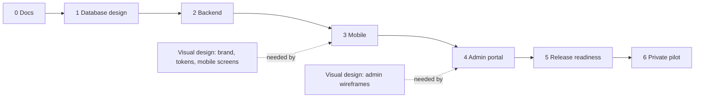
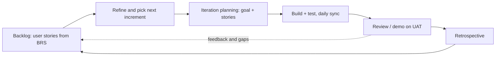

# Jamii Air — Implementation Plan

| | |
|---|---|
| **Document** | 06 — Implementation Plan |
| **Version** | 1.8 (Phase 2 backend built and tested locally; app identifiers set; API review record) |
| **Status** | **Approved** — 2026-10-11 |
| **Date** | 2026-10-10 |
| **Team** | 1 engineer building with Claude Code; Product (stakeholder) as product owner |
| **Related** | All documents 00–05 |

---

## 1. Summary

The work is done **one layer at a time**, bottom-up, and **each layer is built in small agile iterations** (§2). Every iteration delivers a working, tested, demonstrable increment, and the backlog is re-prioritised after each one. A layer is finished when its exit gate passes, so every layer is built on top of something that already works.

| Phase | Layer | Folder | Outcome |
|---|---|---|---|
| **0** | **Docs** | `docs/` | Documents approved, open questions answered, accounts and legal texts ready |
| **1** | **Database design** | `backend/prisma/` | Complete schema and every stored procedure, with integration tests, on PostgreSQL 18 |
| **2** | **Backend** | `backend/` | Full REST API (`/api/v1`, `/api/v1/admin`), media and push workers, running on UAT |
| **3** | **Mobile** | `mobile/` | Complete app against the UAT API, tested on Android (iOS verified in Phase 5) |
| **4** | **Admin portal** | `admin/` | Moderation web app against the UAT admin API |
| 5 | Release readiness | all | Production, backups, load test, security review, store listings |
| 6 | Private pilot | — | 10 users complete the core loop; go/no-go for R1.1 and R2 (Reels) |

**No time estimates.** Iterations are goal-based, not time-boxed: an iteration ends when its goal is met (demoed and accepted), and a phase ends when its **Exit** gate passes. The next one starts immediately.

Visual design (Design Brief, doc 04) is produced by the engineer with Claude Code: the mobile designs as the first increment of Phase 3, the admin wireframes as the first increment of Phase 4.

**Status (2026-10-11):**

| Phase | State | Tracker |
|---|---|---|
| 0 Docs | ✅ Complete | §4 Phase 0 |
| 1 Database design | Built and tested locally; in **Review** | [Phase 1 backlog](backlog/phase-1-database-E0-E1.md#status) |
| 2 Backend | Built and tested locally; exit gate met locally (UAT deferred); in **Review** | [Phase 2 backlog](backlog/phase-2-backend.md#status) |
| 3 Mobile | **Next.** Scaffold (part of 3.1) and Expo account (3.3) exist | §4 Phase 3 |
| 4 Admin portal | Not started; the admin API it needs is done (2.12) | §4 Phase 4 |
| 5–6 Release, pilot | Not started | §4 Phases 5–6 |

- **Database:** 11 migrations and 94 functions. The drift check passes, and the 123 procedure tests pass, including the authorization matrix and the SR-01/03/04 security checks. Every measured P95 is under 50 ms at 10k users / 1M posts (task 1.13).
- **Backend:** 56 API paths, all in the OpenAPI spec. 47 unit and 77 e2e tests pass, including a spec-driven authorization sweep and the upload-security tests. Every endpoint has an e2e call. The API was reviewed against every App Flow screen ([07-api-review.md](07-api-review.md)).
- **Open before Phases 1 and 2 are Done:**
  - push `main` (it is ahead of `origin`), check CI on GitHub, and review the commits;
  - make the **Database** and **Backend** checks required in `main`'s branch protection;
  - create the GitHub board (the `gh` CLI is not installed yet; §9).
- **Deferred (local dev only until development is finished):** the UAT deploy, Sentry and metrics (task 2.16).
- **Repository:** [`baraka-machumu/jamii-air`](https://github.com/baraka-machumu/jamii-air) on GitHub. `backend/` holds the API, worker and database; `mobile/` has the Expo scaffold; `admin/` is a placeholder.

## 2. Agile delivery model

### 2.1 How the layer order and agile fit together

The **layer order is the outer loop** (Phase 0 → 6). **Inside each layer, work is agile**: the layer's tasks are split into increments by **epic**, built one increment at a time, each one deployed to UAT and demoed before the next starts.

Feedback flows **backwards** freely: if the mobile layer finds a missing field or endpoint, a story is added to the backlog and fixed in the database/backend layer straight away (migration + procedure + tests + API), without waiting for a new phase.

### 2.2 Epics and increments

Epics come from the BRS (doc 01 §8). Each layer delivers the epics **in the same order**, so each increment is a slice of that layer that can be demoed on its own.

| # | Epic (BRS) | Phase 1 — Database | Phase 2 — Backend | Phase 3 — Mobile | Phase 4 — Admin portal |
|---|---|---|---|---|---|
| E0 | Foundation | 1.1–1.3, 1.14 | 2.1–2.4, 2.16 | 3.1–3.3 | 4.1, 4.7 |
| E1 | Accounts & access (BR-AC) | 1.4 | 2.5 | 3.4 | 4.2 |
| E2 | Profiles & social graph (BR-PR) | 1.5 | 2.6 | 3.5–3.6 | — |
| E3 | Content (BR-CT) | 1.6 | 2.7–2.8 | 3.7 | — |
| E4 | Feed & engagement (BR-FD) | 1.7–1.8, 1.13 | 2.8–2.9 | 3.8–3.9 | — |
| E5 | Notifications (BR-NT) | 1.9 | 2.10 | 3.10 | — |
| E6 | Safety & moderation (BR-SF) | 1.10 | 2.11–2.12 | 3.11 | 4.4–4.6 |
| E7 | Data & insight (BR-DI) | 1.11 | 2.13 | 3.12 | 4.3 |
| E8 | Quality & hardening | 1.12 | 2.14–2.15 | 3.12 | 4.8 |

**One iteration = one increment** (one cell of the table), or a smaller slice of it if the increment is large. Phase 0 (docs) and Phase 5 (release readiness) each run as one iteration.

### 2.3 Backlog

| Item | Agreement |
|---|---|
| Tool | GitHub Projects board **Jamii Air** linked to the repo; stories are drafted in [`docs/backlog/`](backlog/) and turned into issues with `create-github-issues.mjs`: **Backlog → Ready → In progress → Review → Done**. |
| Stories | Written as *"As a ⟨persona⟩, I want ⟨goal⟩ so that ⟨benefit⟩"*, linked to a BRS ID (e.g. BR-AC-01) and an epic; labels `db`, `api`, `mobile`, `admin`. Technical work (e.g. the drift check) is written as a team story. |
| Priority | MoSCoW from the BRS (M / S / C). **Must** stories first; Should and Could stories are pulled in only after the Musts of that increment are Done. The scope-cut order (§8) is the bottom of the backlog. |
| Refinement | Before each iteration: split the next increment into stories, add acceptance criteria, check the Definition of Ready. |
| WIP limit | At most 2 stories **In progress** at once: finish before starting. |

**Definition of Ready (a story can enter an iteration when):** it has a BRS ID or a stated technical reason; acceptance criteria are written (Given / When / Then); the procedure, endpoint or screen it touches is named; the lower-layer stories it depends on are Done; for UI stories, the design is available.

### 2.4 Ceremonies (goal-based, no fixed lengths)

| Ceremony | When | Output |
|---|---|---|
| Iteration planning | Start of each increment | Iteration goal (one sentence) + selected stories |
| Daily check-in | Each working day | Engineer updates the board: done / next / blockers; blockers raised with the product owner |
| Review / demo | When the iteration goal is met | Demo on UAT (Swagger or test scripts for database and backend; reference Android for mobile; browser for admin). Product owner accepts or adds stories. |
| Retrospective | After each review | 1–3 concrete improvements, added to the backlog |
| Phase gate | When all increments of a layer are Done | Exit criteria checked; move to the next layer |

### 2.5 Roles

| Role | Who | Responsibilities |
|---|---|---|
| Product owner | Product | Orders the backlog; writes and accepts stories; accepts each review |
| Engineer | 1 engineer | Splits stories small; builds, tests, demos; runs planning, review and retro; keeps the board current; reviews and merges everything |
| AI pair | Claude Code | Drafts code, migrations, procedures, tests, designs and docs per story; runs code reviews (`/code-review`) on every PR |

### 2.6 Progress tracking (no time estimates)

Progress is tracked by **flow**, not deadlines: stories Done per iteration, cycle time per story (In progress → Done), open bugs, and the **epic burn-up** (Must stories Done ÷ total, per layer). These are discussed at the retrospective and never used as targets.

## 3. Ways of working

| Topic | Agreement |
|---|---|
| Repository | One Git repository, `jamii-air`, with sibling apps `backend/`, `mobile/`, `admin/` and `docs/`. The apps share no code; `mobile/` and `admin/` talk to `backend/` only over HTTP and generate their API types from the backend's OpenAPI spec. |
| Branching | `main` always deployable. Short-lived branches `feat/<layer>-<topic>` (e.g. `feat/db-auth`, `feat/mobile-feed`), PR with CI green and a Claude Code review (`/code-review`) before the engineer merges; squash merge. |
| Commits | Conventional Commits, scoped by app: `feat(db): …`, `feat(api): …`, `feat(mobile): …`, `feat(admin): …`. |
| CI gate | lint · typecheck · unit · **stored-procedure integration tests** · **SP drift check** · API e2e · build (backend, mobile typecheck, admin build). Each app's jobs run only when its folder changes. |
| Database changes | Every table or procedure change = a migration + updated file under `backend/prisma/functions/` + integration tests, in the same PR (TRD §6.3). Signature changes follow expand → contract. |
| Deploys | Merge to `main` → UAT (API, worker, admin portal). Production = manual approval. Mobile: EAS `preview` build at the end of each mobile milestone. |
| Tracking | One GitHub issue per story; labels by layer (`db`, `api`, `mobile`, `admin`) and epic (`E0`…`E8`); milestone per phase; board as in §2.3. |
| Docs | API or schema changes update TRD / Schema doc in the same PR. ADRs in `docs/adr/`. |

### Definition of Done (every task)

1. Code merged with review; CI green.
2. Every new or changed stored procedure has integration tests: happy path, each error code it raises, and authorization cases (owner / other user / blocked / suspended / admin role).
3. API changes reflected in OpenAPI; mobile and admin types regenerated.
4. Mobile: loading, empty, error and offline states; strings in `en` and `sw`.
5. No secrets, tokens, passwords or dates of birth in logs.
6. Works on the reference Android device (mobile) / latest Chrome & Edge (admin).

## 4. Phase-by-phase plan

### Phase 0 — Docs

| # | Task | Owner |
|---|---|---|
| 0.1 | ✅ BRS signed off (2026-10-10); ✅ open questions answered (D-7…D-12, [00 §3a](00-README.md)); ✅ docs 00, 02–06 approved (2026-10-11) | Product + Engineer |
| 0.2 | ✅ GitHub account (barakabryson@gmail.com); ✅ repo [`baraka-machumu/jamii-air`](https://github.com/baraka-machumu/jamii-air); Container Registry when 2.16 needs it. Other accounts are **not needed now** — see 5.0 | Engineer |
| 0.3 | ✅ App identifiers: Android package and iOS bundle ID **`tz.jamiiair.app`**, URL scheme `jamiiair`. Domain and DNS move to 5.0 — UAT is reached by IP | Product |
| 0.4 | Terms of Service (incl. **18+ requirement**), Privacy Policy, Community Guidelines — legal review | Product |
| 0.5 | Product reviews doc 04 (Design Brief); designs are produced by the engineer with Claude Code in Phases 3–4 | Product |
| 0.6 | Reference device: 1 mid-range Android (testing is **Android-only** for now; an iPhone is added in 5.0) | Engineer |
| 0.7 | ✅ Local development environment ready (Docker 29 + Compose v5, Node 24, Git). UAT server access: address provided through the environment variable `UAT_SERVER_IP`; confirm SSH key access before the first UAT deploy (2.16). Production servers move to 5.0 | Engineer |

**Exit:** ✅ docs approved; ✅ GitHub repo exists; ✅ local Docker works. **Phase 0 complete (2026-10-11).**

### Phase 1 — Database design

The whole data layer from the Schema document (doc 05): every table, constraint, index and stored procedure, tested directly in PostgreSQL before any API code uses it. Lives in `backend/prisma/`.

| # | Task |
|---|---|
| 1.1 | ✅ `docker-compose.yml` at `backend/`: **PostgreSQL 18**, Redis 7, MinIO (+ bucket init), Mailpit; init script creating roles `jamii_owner`, `jamii_app` |
| 1.2 | ✅ Prisma setup (ESM client, TypedSQL enabled); migration `init` (extensions, enums, `fn__touch_updated_at`, helper functions, grants script) |
| 1.3 | ✅ **Stored-procedure framework:** ✅ `prisma/functions/` layout; ✅ `npm run db:fn-migration` script; ✅ **drift check** (fresh DB → compare `pg_get_functiondef` with source files); Testcontainers harness that calls functions as `jamii_app`; security checks from TRD §13.1 (SR-01 direct-write test, SR-03 `search_path` check, SR-04 `EXECUTE` grep); sample `fn_ping(p_viewer_id)` raising `JA404` |
| 1.4 | ✅ Migration `users_auth`: users (DOB + **18+ CHECK**), invite_codes, refresh_tokens, password_reset_codes, device_push_tokens. Procedures: `fn_register_user` (age ≥ 18, invite, first session), `fn_get_login_candidate`, `fn_create_session`, `fn_rotate_refresh_token` (reuse detection), `fn_revoke_session`, `fn_update_profile`, `fn_get_profile`, `fn_create_password_reset` (S), `fn_reset_password` (S) |
| 1.5 | ✅ Migration `social_graph_search`: follows, blocks, trigram indexes. Procedures: `fn_follow_user`, `fn_unfollow_user`, `fn_get_followers`, `fn_get_following`, `fn_search_users` |
| 1.6 | ✅ Migration `media_posts`: media_assets, media_variants, posts, post_media, idempotency_keys, pending_object_deletions. Procedures: `fn_create_upload_intent`, `fn_create_post` (ownership, idempotency), `fn_complete_media_processing`, `fn_fail_media_processing`, `fn_get_post`, `fn_delete_post`, `fn_update_post_caption` (C) |
| 1.7 | ✅ Feed procedures `fn_get_home_feed`, `fn_get_profile_posts` + index tuning |
| 1.8 | ✅ Migration `engagement`: likes, comments. Procedures: `fn_like_post`, `fn_unlike_post`, `fn_add_comment`, `fn_delete_comment`, `fn_get_post_comments` |
| 1.9 | ✅ Migration `notifications`; notification inserts in like/comment/follow procedures (dedupe, no self); procedures `fn_get_notifications`, `fn_get_unread_count`, `fn_mark_notifications_read`, device-token functions, `fn_get_push_payload`, `fn_mark_notification_pushed` |
| 1.10 | ✅ Migration `moderation_admin`: reports, moderation_actions, admin_users, admin_sessions, admin_audit_log. Procedures: `fn_block_user`, `fn_unblock_user`, `fn_get_blocked_users` (+ block filtering in **every** read procedure), `fn_submit_report`, `fn_request_account_deletion`, all `fn_admin_*` (auth, dashboard, reports, users, content, invites, audit, admins) |
| 1.11 | ✅ Migration `metrics_maintenance`: daily_metrics; all `fn_maint_*` (upload-intent cleanup, stuck-media requeue, object-deletion claim/complete, idempotency purge, content/account purges, counter reconciliation, daily metrics); final grants |
| 1.12 | ✅ Procedure test suite: under-18 rejected by the CHECK; duplicate username in any letter case; refresh-token reuse revokes the family; follow/like counters correct under parallel calls; blocked users invisible in every read; authorization matrix per procedure |
| 1.13 | ✅ Seed 10k users / 1M posts in a scratch DB; measure with `auto_explain` (plans inside functions). `npm run db:perf`; results: 10k users, 1M posts, 1.47M follows, 3M likes, 300 viewers, as jamii_app, local Docker. P95: feed 27 ms (page 2: 17), grid 6, comments 3, notifications 8, unread 4, profile 3, search 8. The Schema v1.1 feed query measured 124 ms; it was replaced by a per-author top-N (Schema §16) |
| 1.14 | ✅ GitHub Actions CI for the database: migrations on a fresh PG 18, procedure tests, drift check (`.github/workflows/db.yml`; branch protection still to be set on GitHub) |

**Exit:** all migrations apply cleanly to a fresh PostgreSQL 18; every procedure in Schema doc §8 exists and passes its tests; the drift check fails when a function file is edited without a migration; `jamii_app` has **no** table write privileges; feed procedure P95 < 50 ms on 1M posts.

### Phase 2 — Backend

NestJS API and workers on top of the finished procedures. The API layer validates input, authenticates, calls procedures and shapes responses; business rules stay in the database.

| # | Task |
|---|---|
| 2.1 | ✅ Backend clean-up: package renamed to `jamii-air-api`; `@nestjs/observe` removed; demo `UserController` deleted |
| 2.2 | ✅ Typed config module with env validation (separate `DATABASE_URL` for the app role and `MIGRATION_DATABASE_URL` for the owner role) |
| 2.3 | ✅ `PrismaService` + TypedSQL call wrappers; common layer: `ValidationPipe`, exception filter with **`JA<status>` SQLSTATE → API error mapping**, request-ID, `nestjs-pino` with redaction, `helmet`, `/api/v1` prefix, health endpoints, Swagger (non-prod) |
| 2.4 | ✅ Cursor codec (encode/decode, sentinel) + tests |
| 2.5 | ✅ Auth module: Argon2id hashing, JWT, token hashing, guards, `@CurrentUser()`, rate limits; password reset email via Mailpit/provider |
| 2.6 | ✅ Users module: profile, edit profile, follow/unfollow, followers/following, search |
| 2.7 | ✅ Media (local: MinIO serves variant keys publicly as the stand-in for the nginx media cache, which comes with the server setup; HEIC is converted on the phone because prebuilt sharp has no HEVC decoder): `StorageService` (presigned PUT with signed type/length, HEAD, delete) for MinIO; **Redis + BullMQ**; throttler → Redis storage; media worker (sharp): decode-validate, auto-orient, **strip EXIF/GPS**, variants, blurhash, retries; nginx media cache for variant paths only + `mediaUrl()` helper |
| 2.8 | ✅ Posts and feed modules (create with `Idempotency-Key`, get, delete, caption edit, home feed, profile grid; media URLs, `nextCursor`) |
| 2.9 | ✅ Engagement: likes, comments; `shareUrl`; landing page for `/p/*`, `/u/*`; `assetlinks.json`, `apple-app-site-association` (identities from env: empty until 0.3 app identifiers exist) |
| 2.10 | ✅ Notifications module + push worker (Expo Push API, batching, receipts, invalid-token cleanup, localised text) |
| 2.11 | ✅ Safety: block/unblock, blocked list, reports, account deletion endpoints |
| 2.12 | ✅ **Admin API** (`/api/v1/admin`): admin login + **mandatory TOTP** (enroll/verify, encrypted secret), cookie-based refresh, `AdminJwtGuard`, `AdminRolesGuard`, CORS for the admin origin only; dashboard, reports, users, content, invites, audit log, admins endpoints |
| 2.13 | ✅ Maintenance worker loops calling the `fn_maint_*` procedures on schedule (BullMQ job schedulers, East Africa Time; object deletions removed from storage between claim and complete) |
| 2.14 | ✅ OpenAPI spec published as a build artifact for mobile and admin type generation; reviewed against App Flow (doc 03) so every screen has the endpoints it needs ([review record](07-api-review.md): 10 gaps fixed, incl. change password, profile share link, 426 version gate, hidden posts on the author's grid) |
| 2.15 | ✅ Tests: API e2e for every endpoint (enforced: a route without an e2e call fails `openapi.e2e-spec`); upload security tests (oversized, wrong type, renamed non-image, another user's `mediaId`, expired intent, replayed idempotency key); **authorization sweep** — every endpoint × (owner, other user, blocked, suspended, user token on admin route, moderator on super-admin route) |
| 2.16 | ✅ Dockerfile (multi-stage), `worker.ts`; ✅ CI (lint, typecheck, tests, build — `.github/workflows/backend.yml`); **deferred (local dev only until development is finished):** UAT deploy to `$UAT_SERVER_IP` (Docker Compose: pull image from GHCR, run migrations, restart); Sentry (enabled once its DSN is set — optional until production) and per-route / per-procedure latency (`pg_stat_statements`, `track_functions`), queue metrics, alerts |

**Status (2026-10-11): met locally** — 77 e2e (incl. the spec-driven authorization sweep and upload security), 123 procedure and 47 unit tests pass; the UAT part waits for the deferred deploy (local dev only until development is finished).

**Exit:** the full API runs on UAT and is documented in OpenAPI; all e2e, security and authorization tests pass; a test script uploads a phone photo and gets WebP variants in MinIO with **no GPS metadata**, and the original is not reachable via the nginx media cache; user tokens are rejected on admin routes.

### Phase 3 — Mobile

The Expo app in `mobile/`, built screen by screen against the finished UAT API. Each milestone ends with a **demo on the reference mid-range Android** and an EAS `preview` build.

| # | Task |
|---|---|
| 3.1 | Foundation (TS strict — ✅ Expo SDK 57 scaffold done): React Navigation (auth stack + tabs), TanStack Query, Zustand, i18next (`en`, `sw`), theme tokens from doc 04 (light/dark), FlashList, expo-image, Sentry |
| 3.2 | API client (timeouts, auth header, `X-App-Version`, error code → localised message) with types generated from the OpenAPI spec |
| 3.3 | ✅ Expo account exists (`bmachumu`). EAS build profiles (project owner `bmachumu`); Android dev build on the reference device; Android push credentials (FCM via EAS). iOS builds and APNs wait for the Apple account (5.0) |
| 3.4 | Auth: Welcome, Sign up (**date-of-birth picker + under-18 message**, invite code), Log in, Forgot password; secure token storage; single-flight silent refresh; session restore |
| 3.5 | Profile: My profile, Edit profile, avatar upload, Settings, language & theme |
| 3.6 | People: Search (debounce, cancel, recent searches), User profile with optimistic Follow, follower/following lists, Onboarding "Find people" |
| 3.7 | Create flow: permissions, picker/camera, crop, downscale (HEIC → JPEG), caption, upload with progress/retry, draft persistence, posting/processing/failed card |
| 3.8 | Feed: Home feed (FlashList, reserved aspect ratio, blurhash, infinite scroll, pull-to-refresh, all states, memoised card); profile grid; Post detail; performance pass on the reference Android |
| 3.9 | Engagement: like button + double-tap animation, debounced optimistic toggle; Comments screen; share sheet, copy link, deep-link routing |
| 3.10 | Notifications: Activity screen, tab badge, permission onboarding, push handling in all app states |
| 3.11 | Safety: block/unblock, Blocked accounts, Report sheet, Delete account flow |
| 3.12 | Quality: Maestro E2E of the core loop in CI; PostHog KPI events (sent once its key is set — optional until production); accessibility pass; min-version (`426`) wiring; EAS Update channel |

**Exit:** on the reference Android against UAT, a new user registers (18+), follows someone, posts a photo, likes and comments, receives a push, and blocks/reports a user; liking post #7 re-renders only post #7; a shared link opens the post on another phone; Maestro E2E green.

### Phase 4 — Admin portal

The moderation web app in `admin/`, against the finished admin API.

| # | Task |
|---|---|
| 4.1 | App setup: React + Vite + TS, shadcn/ui, routing, API client with types from the OpenAPI spec |
| 4.2 | Auth flow: login, 2FA setup, 2FA code, session expiry |
| 4.3 | Dashboard (KPI cards from `daily_metrics`, open reports, suspended users, invites remaining) |
| 4.4 | Reports queue & detail; post/comment view; hide / restore content |
| 4.5 | Users list & detail; suspend / reinstate |
| 4.6 | Invite codes; Audit log; Admins management (super-admin only) |
| 4.7 | Hosting: build in CI, serve the static files from nginx on our servers; **IP allowlist** for the portal and `/api/v1/admin/*` |
| 4.8 | Playwright E2E in CI |

**Exit:** from the portal, an admin (with 2FA) resolves a report, hides a post, suspends and reinstates a user, and creates an invite code; each action appears in the audit log; Playwright E2E green.

### Phase 5 — Release readiness

| # | Task |
|---|---|
| 5.0 | Production prerequisites (deferred from Phase 0, D-12): production servers in the Tanzanian data centre (Linux, Docker + Compose, firewall, SSH keys, static IPs, separate disks for PostgreSQL, MinIO and backups); domain + DNS + `admin.` sub-domain; accounts: Apple Developer (+ an iPhone as second reference device), Google Play Console, Sentry, PostHog, transactional email provider; office IP addresses for the admin allowlist |
| 5.1a | **iOS pass:** iOS build via EAS, APNs push credentials, run the Maestro core loop and a manual check (incl. HEIC photo upload) on the iPhone; fix iOS-only issues |
| 5.1 | Production on our servers (Docker Compose: API, worker, PG 18, Redis, MinIO, nginx with TLS + media cache, admin portal + IP allowlist); secrets; firewall; disk and container-health alerts |
| 5.2 | Backups: pgBackRest (daily + WAL archiving for PITR) with an off-server copy; MinIO mirror; **restore drill** with runbook |
| 5.3 | k6 load test (10× pilot, 10k-DAU model); fix regressions |
| 5.4 | Security review: OWASP API Top 10 checklist, `SECURITY DEFINER` review (search_path set on every function, no dynamic SQL), dependency audit, log redaction check |
| 5.5 | PostHog dashboard numbers cross-checked against `daily_metrics` |
| 5.6 | Swahili copy review |
| 5.7 | App store assets; **18+ age rating**; privacy labels / Data Safety; TestFlight and Play internal testing |

**Exit:** deployment checklist (Spec §15) complete; restore tested; all E2E suites green; load test within TRD §14 budgets.

### Phase 6 — Private pilot

The pilot is the only stage paced by real users rather than by build speed: it runs until the users have had a fair chance to complete the core loop (BO-1 measures each user's first week).

| Stage | Activity |
|---|---|
| Start | Onboard 10 invited adult users (TestFlight / Play internal testing); invite codes created in the admin portal; admin on call. |
| Throughout | Check the admin dashboard daily; triage crashes within 24 h; handle reports within 24 h; ship fixes via EAS Update or new builds as needed. |
| Mid-pilot | Mid-pilot interviews (5 users): onboarding, posting on weak networks, **appetite for Reels**. |
| End | Pilot review: KPIs vs BRS §10, incidents, cost actuals, feedback. **Go / no-go for R1.1 and R2 planning.** |

**Exit (Release 1 acceptance):** all Spec §17 criteria pass and ≥ 8/10 users completed the core loop (BO-1).

## 5. Acceptance-criteria traceability

| Spec §17 criterion | Phases | Verified by |
|---|---|---|
| New user can register and log in (18+) | 1, 2, 3 | Procedure + API tests, Maestro |
| Users can find and follow each other | 1, 2, 3 | Procedure tests, Maestro |
| Photo uploads go directly to object storage | 2, 3 | Integration test (API never receives bytes) |
| Published posts appear in followers' feeds | 1, 2, 3 | Procedure tests, Maestro |
| Like/unlike works | 1, 2, 3 | Procedure tests, Maestro |
| Comments created/deleted by owner | 1, 2, 3 | Procedure + authz tests |
| Follow/like/comment create notifications | 1, 2, 3 | Procedure tests, device demo |
| Blocking changes visibility/interactions | 1, 2, 3 | Procedure tests, authz sweep (2.15) |
| Reports appear in admin moderation | 2, 4 | Playwright + demo |
| Admin can hide content / suspend account | 2, 4 | Playwright + audit log |
| Users can delete content and initiate account deletion | 1, 2, 3 | API tests |
| Database restoration tested | 5 | Restore drill record |
| Errors and failed jobs are observable | 2, 5 | Sentry + queue dashboard |

## 6. Post-MVP roadmap (directional)

| Release | Key work | Entry criteria |
|---|---|---|
| **R1.1 — Public launch** | Open sign-up + email verification; carousel (≤ 10 photos); illegal-content hash matching; PgBouncer; public store release; low-data mode | Pilot go decision |
| **R2 — Reels** | Video upload (resumable multipart); transcoding worker (FFmpeg → HLS 360p/720p + poster, or a managed video service — decide on cost); Reels tab with vertical pager and preloading; view counts; data-saver; video moderation in the admin portal; new procedures such as `fn_get_reels_feed` | R1.1 stable; video storage/CDN cost model approved |
| R3 — Discovery | Explore page, hashtags & mentions, better search. **AI/ML features will be designed in a separate document before R3.** | ≥ 1,000 DAU |
| R4 — Scale & engage | Stories, DMs, multiple API instances, read replica | Measured triggers (TRD §17) |

Each release follows the same model: layer order docs → database → backend → mobile → admin portal, built in agile increments by epic.

## 7. Risks & mitigations (delivery)

| Risk | Impact | Mitigation |
|---|---|---|
| **API gaps found only when mobile starts** (layer-by-layer order means screens come last) | Rework in Phases 1–2 | Task 2.14 reviews the OpenAPI spec against every App Flow screen before Phase 2 exits; gaps found later become backlog stories fixed straight away in the lower layer (§2.1). |
| **Stored procedures slow delivery** (PL/pgSQL less familiar, more tests) | Phase 1 slips | Reference implementations in Schema §8 as templates; Claude Code drafts procedures and tests; every procedure reviewed (`/code-review`) and covered by integration tests. |
| **Drift between procedures and code, or deploy-order bugs** | Production errors | Source files + migrations + CI drift check; expand → contract signatures (TRD §6.3). |
| **Debugging inside the database is harder** | Slower incident fixes | Every `JA` error logged with the procedure name; `pg_stat_statements` + `auto_explain` in UAT; integration tests reproduce bugs. |
| **Self-hosting adds operations work** (backups, upgrades, disks, security patches, uptime) | Outages or data loss | One Docker Compose stack per environment; pgBackRest + off-server copy; restore drill (5.2); disk/health alerts; written runbooks; PostgreSQL 18 image pinned (fallback: `uuidv7()` SQL function on PG 17). |
| **Single engineer** (bus factor 1, no second reviewer) | Knowledge loss; unreviewed mistakes | Everything in docs, ADRs and the backlog; Claude Code review on every PR; CI gates (tests, drift check, security checks) cannot be skipped. |
| NestJS 12 / Prisma ESM / TypedSQL friction | Phases 1–2 slip | Time-box it; fall back to `$queryRaw` tagged templates with hand-written types. |
| Admin portal scope grows | Phase 4 slips | Fixed screen list (Design Brief §13); shadcn/ui components; wireframe-level design. |
| HEIC handling on iOS | Upload failures | Client converts to JPEG; worker supports HEIF (covered by worker tests with HEIC samples in 2.7); test on a real iPhone in Phase 5 (5.1a). |
| App store review (UGC + 18+) | Pilot start slips | Pilot via TestFlight/Play internal testing; UGC features done in Phases 3–4; age rating set in Phase 5. |
| Latency from Kenya to Tanzanian servers | Slower app for Kenyan users | Measure from Nairobi during the Phase 2 UAT deploy; add a third-party CDN in front of nginx if image loading is slow. |

## 8. Scope-cut order (bottom of the backlog)

If priorities change, these stories are dropped first, in this order: 1) Caption edit (C) · 2) followers/following lists (S) · 3) password reset (S — admins trigger resets manually) · 4) admin "Admins" management page (super-admin manages admins via a seed/SQL script during the pilot) · 5) dashboard trend charts (keep KPI numbers) · 6) dark mode.

**Never cut:** 18+ enforcement, auth security, stored-procedure authorization tests, EXIF stripping, block/report, admin portal core (login + 2FA, reports, hide, suspend, audit log), account deletion, backups + restore test.

## 9. Immediate next steps

1. ✅ Phase 0 complete: BRS signed off, documents approved, decisions D-7…D-12 recorded, repo on GitHub.
2. ✅ **Phase 1 · Database** built and tested locally (tasks 1.1–1.14).
3. ✅ **Phase 2 · Backend** built and tested locally (tasks 2.1–2.16; UAT deploy deferred).
4. **Close Phases 1 and 2** (Review → Done):
   - push `main` and check the Backend and Database CI runs on GitHub;
   - review the Phase 1 and 2 commits, then make both checks required in `main`'s branch protection;
   - create the board: `winget install GitHub.cli`, `gh auth login`, `gh auth refresh -s project`, then `node docs/backlog/create-github-issues.mjs <backlog file>`. Until then the backlog files are the tracker.
5. **Start Phase 3 · Mobile:**
   - first increment: the mobile designs (Design Brief, doc 04);
   - then 3.1 (navigation, TanStack Query, Zustand, i18n, theme tokens);
   - then 3.2 (API client generated from `npm run openapi`).
   - Draft the stories in `docs/backlog/phase-3-mobile.md` before starting.

